# pcap_to_json 工作台風格：第一輪五個方向（2026-11-09）

> 📘 **REFERENCE** ｜ **日期**：2026-11-09 ｜ **用途**：回應 [style_prompt_2026-11-09](style_prompt_2026-11-09.md) §1 的第一輪 prompt——五個淺色＋深色的風格方向（配色、字型、密度、元件樣式、排版），每個方向附主畫面、設計理由、完整變數、版面數字、元件差異。
> **怎麼做的**：不是手繪稿。每張圖都是 `snapshot_main.html`（c686fd4 的真實 DOM＋全部 CSS）套上該方向的 CSS，用 headless Chromium 1440 × 900、deviceScaleFactor 1 渲染；資料與文案全部來自快照，沒有編造。CSS、產圖與檢查腳本都在 [style_directions_2026-11-09/](style_directions_2026-11-09/)。
> **限制**：快照只有主畫面（附件 01 的狀態），所以這一輪只畫主畫面；其他狀態（bytes、解碼面板、比對、匯出…）留到第二輪，見 §9。

## §0 一頁看完 / Summary

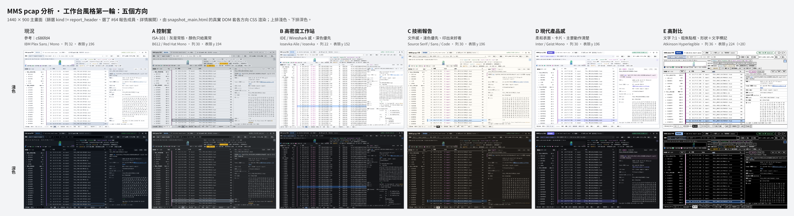

| 方向 | 一句話 | 適合 | 不適合 |
|---|---|---|---|
| **A 控制室** | ISA-101：灰是常態，顏色只給異常 | 長時間監看、投影、在上萬列裡找異常 | 靠顏色分 request / response 的日常瀏覽；彩色印刷報告 |
| **B 高密度工作站** | IDE / Wireshark 感，等寬為主，深色優先 | 熟 Wireshark、鍵盤操作、大量列（可見 31 列，+55%） | 投影給外人、低視力；截圖字偏小 |
| **C 技術報告** | 排好版的技術文件，三線表、襯線標題 | 截圖貼報告、印出來、讀長結構 | 最高密度、長時間監看 |
| **D 現代產品感** | 卡片、柔和陰影、膠囊元件、實心主要按鈕 | 新手、展示、對外場合 | 最大密度；樸素的報告截圖 |
| **E 高對比** | 文字 ≥ 7:1、3 px 焦點框、≥ 32 px 點擊範圍、色彩外加形狀與文字 | 戶外、投影、低視力 | 日常大量瀏覽（可見列 16） |

**我的建議（給第二輪參考）**：主力用 **B**，把 A 的一條規則搬進來——「正常狀態不著色，只有警告 / 錯誤計數變色塊」；**E** 做成第三個主題（`data-theme="contrast"`），投影或戶外時切換。三者共用同一套變數（§1），多一個主題只是多一段 `:root[...]`。C 的 `@media print` 規則與 A / B / D / E 都相容，可以單獨拿來用。

### 版面數字對照（px）

| | 現況 | A 控制室 | B 高密度分析工作站 | C 技術報告 | D 現代產品感 | E 高對比 |
|---|---|---|---|---|---|---|
| 頂欄 / 篩選列 / 總覽帶（收合） / 工具列 / 底部分頁 | 44 / 40 / 112（28）/ 32 / 300 | 44 / 40 / 110（28）/ 32 / 300 | 34 / 32 / 86（22）/ 26 / 280 | 48 / 40 / 108（28）/ 32 / 320 | 46 / 42 / 100（30）/ 38 / 300 | 52 / 48 / 124（36）/ 44 / 320 |
| 表頭起點 y（1440 × 900） | 196 | 194 | 152 | 196 | 196 | 224（+28） |
| 三欄：樹 / 列表 / 詳情 | 18%（下限 200）/ 其餘 / 32%（下限 320） | 16%（下限 200）/ 其餘 / 34%（下限 340） | 14%（下限 180）/ 其餘 / 30%（下限 320） | 16%（下限 200）/ 其餘 / 36%（下限 360） | 17%（下限 200）/ 其餘 / 33%（下限 340） | 18%（下限 210）/ 其餘 / 34%（下限 360） |
| 1440 寬實際 px | 259 / 720 / 461 | 230 / 720 / 490 | 202 / 806 / 432 | 230 / 691 / 518 | 241 / 690 / 469（卡片＋間距） | 259 / 691 / 490 |
| 列高（密集）/ 可見列 | 32（24）/ 20 | 30（24）/ 21 | 22（18）/ 31 | 30（24）/ 21 | 30（24）/ 20 | 36（30）/ 16 |
| 字級：介面 / 列表 / 按鈕 / 小字 | 14 / 13 / 13 / 12 | 14 / 13 / 13 / 12 | 12.5 / 12.5 / 12 / 11.5 | 14 / 13.5 / 13.5 / 12.5 | 13.5 / 13 / 13 / 12 | 15 / 14 / 14 / 13 |
| 按鈕 / 小按鈕 / chip / 樹列 | 30 / 24 / 22 / 26 | 28 / 24 / 22 / 26 | 24 / 20 / 18 / 20 | 28 / 24 / 22 / 26 | 30 / 26 / 22 / 28 | 36 / 32 / 26 / 32 |
| 圓角：一般 / 小 / 浮出層 | 6 / 4 / 10 | 3 / 2 / 4 | 2 / 2 / 3 | 3 / 2 / 4 | 8 / 6 / 12 | 4 / 3 / 6 |
| 間距單位 / kind 色條 | 4 / 3 | 4 / 4 | 3 / 2 | 4 / 0 | 4 / 3 | 4 / 6 |

- 頂部三條（頂欄＋篩選列＋總覽帶）合計：現況 196、A 194、B 152、C 196、D 188（＋卡片間距 8 → 表頭 196）、E 224。只有 E 比 196 低，低 28 px，換到的東西見 §6。
- **1280 寬**：五個方向的頂欄、篩選列、工具列都不折行、沒有元素被切（腳本量每個子元素是否超出、是否換到第二行；截圖 `X_1280.png`）。

## §1 五個方向共用的部分 / Shared

### 1.1 新增的變數（五個方向都定義同一組名字）

tokens.css 原有的名字全部保留、意思不變；新增的如下。`_v2_layer.css` 把 app.css 裡寫死的數字與 `color-mix()` 改成讀這些變數，**預設值就是現在的畫面**（只套這一層時，渲染結果與不套時逐像素相同，0.0000% 不同）。

| 變數 | 用途 |
|---|---|
| `--k-req` `--k-resp` `--k-err` `--k-rpt` | 紀錄種類色（列左邊條、kchip、錯誤列文字），跟狀態色 `--info/--ok/--err/--vio` 脫鉤；A 靠這個把 kind 調淡而警告維持鮮豔。 |
| `--ctl-bg` | 控制類列（fc = CO）的底色；原本是 `--warn` 12%。 |
| `--rule-info` … `--rule-accent` | 著色規則 6 種列底色（藍 / 綠 / 黃 / 紅 / 紫 / 強調色），直接給色，不再用 `color-mix` 推，才能逐一調到分得開。 |
| `--sel-bg` `--sel-edge` | 選取列的底色與框線色；原本與 `--nav-active` 共用，著色規則的「強調色」底跟選取列幾乎一樣。 |
| `--changed` | 比對裡被改過的欄位底色；原本是 `--err` 14%。 |
| `--shadow-pop` | 浮出層（popover / menu / pop）的陰影。 |
| `--h-top` `--h-filter` `--h-ov` `--h-ovmini` `--h-status` `--h-bottom` | 頂欄 / 篩選列 / 總覽帶（展開、收合）/ 工具列 / 底部分頁高度。 |
| `--h-ctl` `--h-ctl-sm` `--h-chip` `--h-node` `--h-hist` | 按鈕與篩選框、小按鈕、chip 與計數藥丸、模型樹列、直方圖繪圖區高度。 |
| `--w-tree` `--w-tree-min` `--w-detail` `--w-detail-min` | 三欄比例與下限。 |
| `--r` `--r-sm` `--r-lg` | 圓角：按鈕與輸入框 / chip 與 kchip / 浮出層。 |
| `--u` `--kind-bar` | 間距單位；列左邊 kind 色條寬。 |
| `--font-chrome` `--font-small` | 頂欄與篩選列按鈕字級；計數、chip、提示字級。 |
| `--serif`（C） | 標題用襯線字。 |
| `--alarm` `--alarm-ink` `--caution` `--caution-ink`（A） | 警報色塊（錯誤）與警示色塊（警告）的底色與字色。 |
| `--shadow-xs` `--shadow-card`（D） | 按鈕與膠囊的細陰影；卡片陰影。 |
| `--focus-halo`（E） | 焦點框外圈，讓 3 px 焦點框在任何底色上都看得到。 |

### 1.2 共用修正（`_v2_fixes.css`，跟風格無關）

- **等寬字不連字**：Iosevka、Geist Mono 預設會把 `!=` 畫成 `≠`、`==` 畫成一條長線；篩選語法與資料必須照原字顯示，所以在 `.mono`、`.cm-editor`、`.vlist` 等關掉 `calt` / `liga`。
- **hex 只在位元組之間換行**：`.hexv` 原本 `word-break: break-all`，詳情的值會把 `3d` 拆成 `3` / `d`（附件 01 就有）；改成 `word-break: normal; overflow-wrap: anywhere`。
- **直方圖疊段之間留 1 px 縫**：`.hist-svg .seg` 加底色描邊，請求 / 回應疊在一起時，色弱也看得出是兩段。
- **圖例在窄螢幕截斷**：`.hist-legend .hint.ml` 超出時用 …，不壓到右邊的計數（E 在 1280 寬才用到）。
- **著色規則的文字標記**：`.row.rule-*` 在 # 欄前加規則名稱（藍 / 綠 / 黃 / 紅 / 紫 / 強）。6 種淡底色在色弱模擬下彼此 ΔE 只有 0.5–1.9，光靠顏色分不開，所以五個方向都加，只是樣式不同。

### 1.3 現況檢查發現的問題（新方向都已處理）

| 問題 | 現況數字 | 方向 A–E |
|---|---|---|
| 直方圖「請求」藍與「報告」紫，綠色盲（deutan）幾乎看不出差別 | ΔE 2.0（淺）/ 1.6（深） | 6.1–18.1（拉開明度） |
| 6 種著色規則列底色彼此太像（淺色「藍」與「強調色」） | ΔE 2.9 | 8.9–12.7 |
| 時間序列線 ser-3 / 5 / 6 對白底不到 3:1 | 最低 2.17:1 | ≥ 3.0:1；4–6 號建議用虛線（uPlot `dash`） |
| 深色 `--dim`（`.fid` 欄位代號，如 `ts`、`frame`）對面板不到 4.5:1 | DOM 實測 3.77:1；對著色規則底 2.67:1 | ≥ 4.5:1（E ≥ 7:1） |
| 淺色 `#63` 連結（`.pairing` 的 `.ref`，強調色在面板上） | DOM 實測 4.04:1 | 各方向 DOM 實測全畫面最低（淺色）：A 5.7、B 4.5、C 5.5、D 4.9、E 8.9 |
| 狀態色當文字放在選取列 / hover 上（例：錯誤列被選取） | 最低 3.32:1 | ≥ 4.5:1（E ≥ 7:1） |

### 1.4 落地時要動到程式的地方（其餘只動 CSS）

1. **列高讀 `--row-h`**：虛擬列表若寫死 32 / 24，要改成讀計算後的 `--row-h`（密集切換也一樣）；「密集」按鈕的 title「列高 32 / 24 px」跟著改數字。
2. **預設欄寬**：B 用 `52 100 92 236 40 96 260 150`；C / D / E 只把 path 從 360 改 320。
3. **時間序列**：uPlot 的線色在繪圖時讀 `--ser-1..6`（換主題要重畫）；4–6 號加 `dash: [7, 4]`。
4. **直方圖**：現在就是 SVG＋class，換色不用改程式。
5. `tests/test_packge_to_json/test_webapp_tokens.py` 要把新變數加進對比門檻（§8 的表就是建議的配對）。

## §2 A 控制室（ISA-101 高效能 HMI）

| 淺色 | 深色 |
|---|---|
| 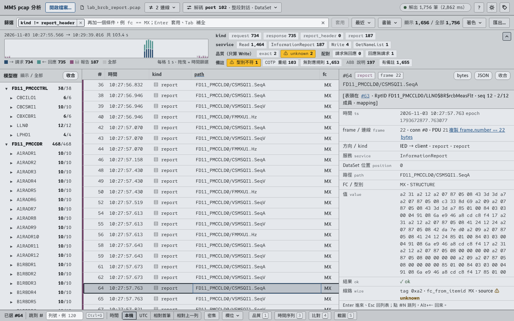 | 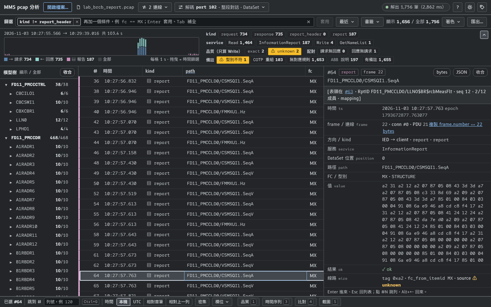 |

**設計理由**

- 整個畫面是中性灰：淺色版的底是 `#d3d6da` 一帶的灰、不是白，深色版是炭灰、不是黑；一般資料用深灰字。沒有大片白底，長時間盯著、投影時眩光最少。
- 顏色只留給「要處理的事」：型別不符、resolver `unknown` 這類警告變成琥珀色塊，錯誤 / 拒絕列與錯誤狀態用警報紅底白字；kind 色降成低彩度，只出現在列左邊條、kchip 和直方圖；「解出 1,756 筆」這種正常狀態不再是綠色。
- 適合長時間監看、實驗室投影、在上萬列裡找異常——異常是畫面上唯一鮮豔的東西。不適合靠顏色快速分 request / response 的日常瀏覽（kind 色刻意調淡，要看符號和文字），也不適合直接截圖放進要彩色印刷的報告。
- 跟現在差在：底色從白 / 藍灰改成灰階；狀態藥丸由綠變中性；總覽計數藥丸只有警告 / 錯誤會變色；選取列是深色框＋灰底，不是藍底；控制列（fc = CO）用斜紋，不是淡黃。

**字型**：B612（Airbus × Intactile 為駕駛艙螢幕設計）＋ Red Hat Mono（OFL 1.1）。latin＋latin-ext 5 個 woff2 共 79 KB。中文一律後備 Noto Sans TC → PingFang TC → Microsoft JhengHei；介面字串固定，可以用 pyftsubset 只留介面用字（主畫面 241 字實測每個字重 51 KB）。

**跟現在不一樣的元件**（完整寫法在 [style_directions_2026-11-09/css/A.css](style_directions_2026-11-09/css/A.css)）

- `.topbar` 底線 2 px；`.tbtn` 灰底（`--surface2`）、3 px 圓角；`.tbtn.out`（開啟檔案…）淺底藍框粗體。
- `.pill.ok` 改中性灰字（只留小綠點）；`.pill.err`、`.decb.bad` 警報紅底白字。
- `.cnt.warn` 琥珀色塊並在 key 前加「⚠」；`.cnt.err` 紅底白字；`.cnt.info / .ok / .vio` 的 key 改中性灰。
- `.filterbar`、`.overview`、`.tree-head`、`.detail-head`、`.hdr` 都用 `--panel` 灰帶；`.hbtn`、`.clabel`、`.cnt-n`、`.counts b` 粗體。
- `.row.sel` 灰底＋ 2 px 深色框（`--sel-edge`）；`.row.ctl` 斜紋底（`--ctl-bg`），`.c-fc` 粗體；`.row.k-error / .k-reject` 整列淡紅、kind 粗體；kind 色條 4 px。
- `.detail .warn` 前加「⚠」並加粗（例：詳情「線路」的 `unknown`）；`.cmp-detail tr.changed td` 加左側深色標記。
- `.statusbar` 上框 2 px；`.segc button[aria-pressed=true]`、`.tbtn[aria-pressed=true]` 灰底深框。
- B612 Mono 試過但不用：它把 `:` `.` 排在字格左邊，`CSMSQI1.SeqA` 會看成 `CSMSQI1. SeqA`、時間變 `10: 27: 56. 832`。

**顏色的意思**（kind、狀態、直方圖、6 條時間序列線、6 種著色規則底色、選取 / 滑過 / 篩選 chip / 焦點框 / 比對被改；上半淺色、下半深色）

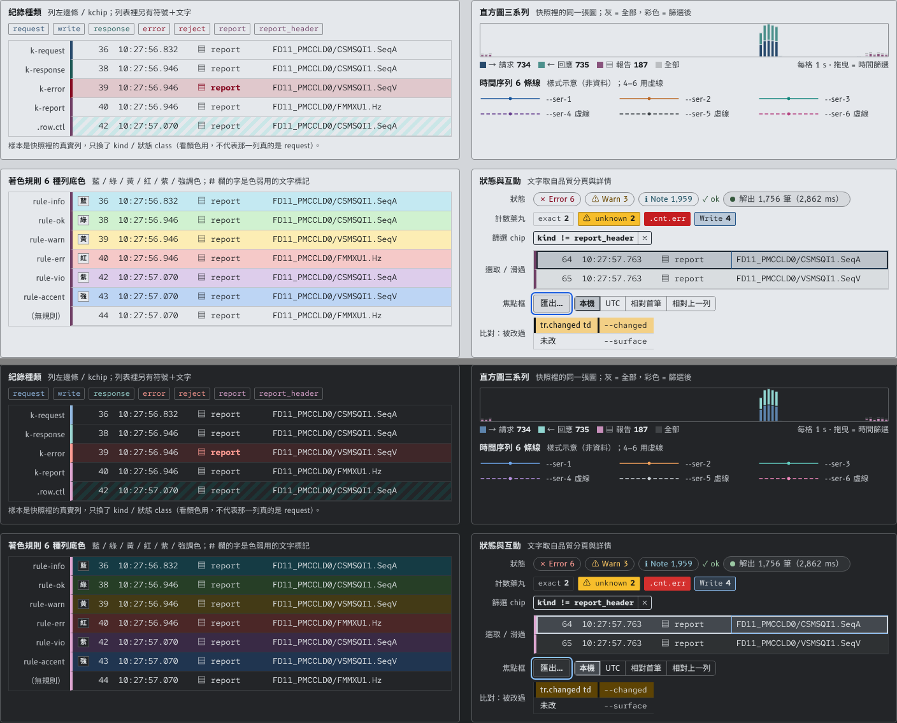

**完整變數**（版面變數只寫在 `:root`，深淺共用）

```css
:root {
  /* 字型 */
  --sans: "B612", "Noto Sans TC", "PingFang TC", "Microsoft JhengHei", system-ui, sans-serif;
  --mono: "Red Hat Mono", "Noto Sans TC", "PingFang TC", "Microsoft JhengHei", ui-monospace, monospace;
  /* 尺寸與版面（深淺共用） */
  --font-ui: 14px; --font-dense: 13px; --row-h: 30px; --h-top: 44px;
  --h-filter: 40px; --h-ov: 110px; --h-ovmini: 28px; --h-status: 32px;
  --h-bottom: 300px; --h-ctl: 28px; --h-ctl-sm: 24px; --h-chip: 22px;
  --h-node: 26px; --h-hist: 54px; --w-tree: 16%; --w-tree-min: 200px;
  --w-detail: 34%; --w-detail-min: 340px; --r: 3px; --r-sm: 2px;
  --r-lg: 4px; --u: 4px; --kind-bar: 4px; --font-chrome: 13px;
  --font-small: 12px;
  /* 表面 */
  --bg: #d3d6da; --topbar: #c6c9cd; --panel: #ccd0d3; --surface: #e5e8ec;
  --surface2: #d6d9dd; --input: #f4f5f7; --border: #898c90; --bsoft: #c1c4c8;
  --hover: #d9dde0; --nav-hover: #d0d3d6; --nav-active: #bac9d9;
  /* 文字 */
  --text: #16191c; --muted: #3c4045; --dim: #484e54; --faint: #646a70;
  /* 強調 / 焦點 */
  --accent: #215285; --accent-solid: #1d4f82; --accent-ink: #ffffff; --focus: #1a5cdf;
  /* 狀態 */
  --ok: #35583d; --warn: #6c4a02; --err: #870b22; --info: #245667;
  --vio: #614572;
  /* 圖表 */
  --ch-req: #284a6c; --ch-resp: #4c908c; --ch-rpt: #89547d; --ch-ghost: #bbbec1;
  --ser-1: #17559b; --ser-2: #ba6826; --ser-3: #12867c; --ser-4: #663e8e;
  --ser-5: #3e4348; --ser-6: #b54481;
  /* 新增：紀錄種類 */
  --k-req: #284a6c; --k-resp: #1e5956; --k-err: #870b22; --k-rpt: #704066;
  /* 新增：列底色 */
  --ctl-bg: #cae6e7; --rule-info: #c4e9f2; --rule-ok: #d0f1d0; --rule-warn: #fcedb4;
  --rule-err: #f5c9c8; --rule-vio: #ddcdeb; --rule-accent: #bdd5f4; --sel-bg: #bdc3ca;
  --sel-edge: #212a33; --changed: #f3d086;
  /* 新增：方向專用 */
  --alarm: #c51e21; --alarm-ink: #ffffff; --caution: #f7be2b; --caution-ink: #0e1216;
  --shadow-pop: 0 2px 0 #0000001f;
}
:root[data-theme="dark"] {
  /* 表面 */
  --bg: #1e2123; --topbar: #292c2e; --panel: #25282b; --surface: #232528;
  --surface2: #2f3235; --input: #171a1c; --border: #585b5e; --bsoft: #34373a;
  --hover: #2e3133; --nav-hover: #2c2e31; --nav-active: #303d4b;
  /* 文字 */
  --text: #dee2e5; --muted: #bdc1c6; --dim: #b1b6bc; --faint: #888d92;
  /* 強調 / 焦點 */
  --accent: #89baed; --accent-solid: #3774b5; --accent-ink: #ffffff; --focus: #8ac3fe;
  /* 狀態 */
  --ok: #9bc8a3; --warn: #f8c562; --err: #fc9b93; --info: #93c7da;
  --vio: #ccace0;
  /* 圖表 */
  --ch-req: #5d84ac; --ch-resp: #91d6d1; --ch-rpt: #c88fbb; --ch-ghost: #414447;
  --ser-1: #6fa7ee; --ser-2: #f4a25c; --ser-3: #63ccc0; --ser-4: #b691e1;
  --ser-5: #ccd2d7; --ser-6: #ef87ba;
  /* 新增：紀錄種類 */
  --k-req: #93b9e1; --k-resp: #9ad4d0; --k-err: #fc9b93; --k-rpt: #dda6d0;
  /* 新增：列底色 */
  --ctl-bg: #1d3536; --rule-info: #153b44; --rule-ok: #263e26; --rule-warn: #433a16;
  --rule-err: #4b2727; --rule-vio: #392a45; --rule-accent: #203550; --sel-bg: #43484e;
  --sel-edge: #d0d8e1; --changed: #5d4304;
  /* 新增：方向專用 */
  --alarm: #d4302e; --alarm-ink: #ffffff; --caution: #f7be2b; --caution-ink: #0e1216;
  --shadow-pop: 0 2px 0 #00000066;
}
.app[data-density=dense] { --row-h: 24px; --font-dense: 12.5px; }
```

## §3 B 高密度分析工作站（IDE / Wireshark 感）

| 淺色 | 深色 |
|---|---|
| 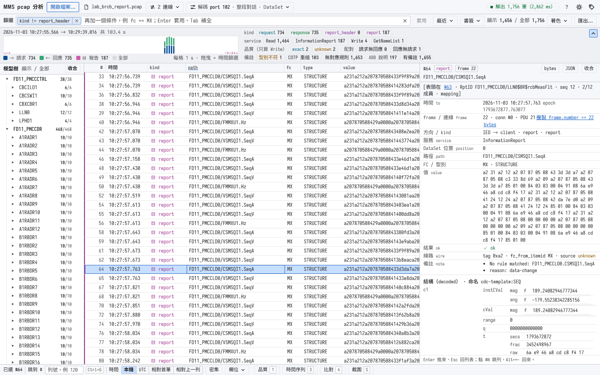 | 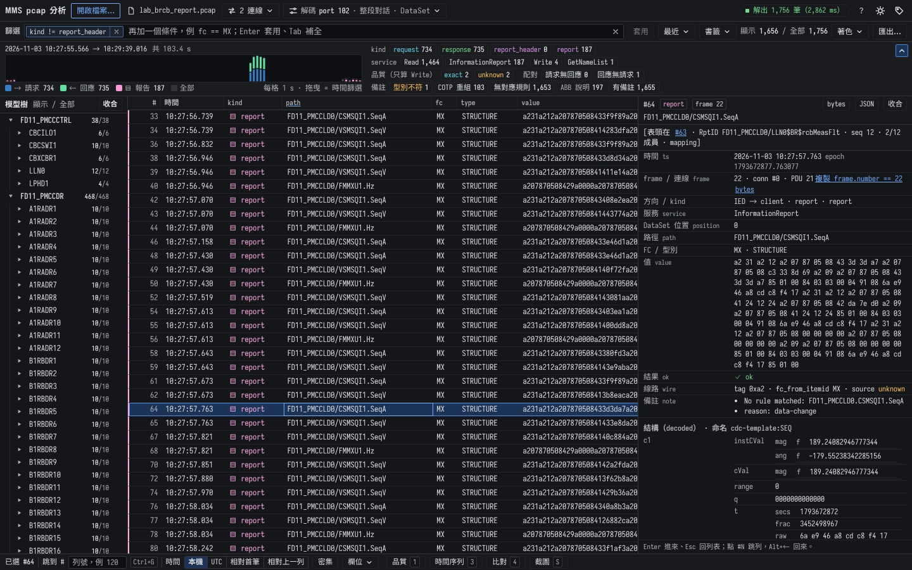 |

**設計理由**

- 一切為了一次看更多：列高 32 → 22 px，頂部三條從 196 px 壓到 152 px，同樣 1440 × 900 可見列從 20 列變 31 列（+55%）；Iosevka 是窄的等寬字，path 欄省約 20% 寬，預設欄寬下列表直接看得到 type、value 兩欄，詳情也多看得到「備註」與「結構（decoded）」。
- 介面也用等寬家族（Iosevka Aile / Iosevka），kind 欄像語法上色（request 藍、response 綠、report 洋紅、error 紅）；1 px 細線、2 px 圓角、沒有陰影；按鈕平時只有淡框，hover 才有底，像 IDE 工具列；模型樹有縮排導線。
- 深色優先：中性石墨灰（不偏藍），選取是 IDE 藍；淺色版是 IDE 淺色主題，同樣密度。
- 適合熟悉 Wireshark / IDE、長時間鍵盤操作、大量列瀏覽的人。不適合投影給不熟的人看、低視力（12.5 px 字、22 px 列），截圖貼報告時字偏小（可配合「截圖 S」）。
- 跟現在差在：密度、字型、kind 文字上色、樹狀縮排導線、預設欄寬變窄。

**字型**：Iosevka Aile（介面）＋ Iosevka（資料），同一家族的比例 / 等寬兩版（OFL 1.1）。原檔 8 個 woff2 共 8.6 MB，要子集化；實測只留 Basic Latin、Latin-1、標點、箭頭、方塊符號 → 8 個共 127 KB。中文一律後備 Noto Sans TC → PingFang TC → Microsoft JhengHei；介面字串固定，可以用 pyftsubset 只留介面用字（主畫面 241 字實測每個字重 51 KB）。

**跟現在不一樣的元件**（完整寫法在 [style_directions_2026-11-09/css/B.css](style_directions_2026-11-09/css/B.css)）

- `.vlist`、`.tree`、`.detail`、`.ovcounts`、`.hist-legend`、`.statusbar`、`.counts` 改等寬字；`:focus-visible` 2 px 貼身外框。
- `.tbtn` 透明底＋淡框（`--bsoft`），hover 才有底；`.tbtn.ib` 無框；`.pill` 透明底、等寬字。
- `.fchip` 強調色 14% 底＋半透明框（像 IDE 搜尋 token）。
- `.overview` 86 px：`.hist-plot` 44 px、`.cnt` 18 px 高、2 px 圓角、透明底。
- `.row .c-kind` 依 kind 上色；`.row.sel` 1 px 強調色框；`.cell` 左右 6 px；kind 色條 2 px。
- `.tnode` 20 px，`.tnode.ln / .seg` 加 1 px 縮排導線；`.tree-head`、`.detail-head`、`.hdr` 用 `--topbar`。
- `.ftable th / td` 上下 1 px、12 px 字；`.statusbar` 26 px、`.segc button` 18 px、`kbd` 透明底細框。
- 預設欄寬（JS）：`52px 100px 92px 236px 40px 96px 260px 150px`（現在 64 / 124 / 118 / 360 / 56 / 104 / 220 / 150）。

**顏色的意思**（kind、狀態、直方圖、6 條時間序列線、6 種著色規則底色、選取 / 滑過 / 篩選 chip / 焦點框 / 比對被改；上半淺色、下半深色）

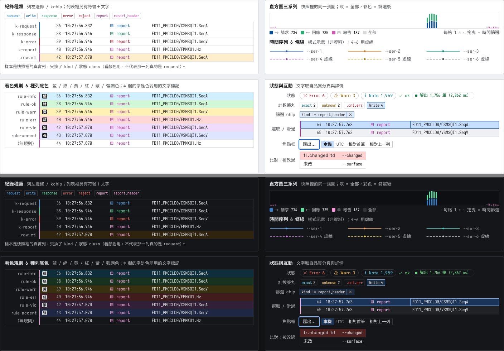

**完整變數**（版面變數只寫在 `:root`，深淺共用）

```css
:root {
  /* 字型 */
  --sans: "Iosevka Aile", "Noto Sans TC", "PingFang TC", "Microsoft JhengHei", system-ui, sans-serif;
  --mono: "Iosevka", "Noto Sans TC", "PingFang TC", "Microsoft JhengHei", ui-monospace, monospace;
  /* 尺寸與版面（深淺共用） */
  --font-ui: 12.5px; --font-dense: 12.5px; --row-h: 22px; --h-top: 34px;
  --h-filter: 32px; --h-ov: 86px; --h-ovmini: 22px; --h-status: 26px;
  --h-bottom: 280px; --h-ctl: 24px; --h-ctl-sm: 20px; --h-chip: 18px;
  --h-node: 20px; --h-hist: 44px; --w-tree: 14%; --w-tree-min: 180px;
  --w-detail: 30%; --w-detail-min: 320px; --r: 2px; --r-sm: 2px;
  --r-lg: 3px; --u: 3px; --kind-bar: 2px; --font-chrome: 12px;
  --font-small: 11.5px;
  /* 表面 */
  --bg: #eff0f3; --topbar: #f5f7fa; --panel: #eff0f3; --surface: #ffffff;
  --surface2: #e8e9ec; --input: #ffffff; --border: #c9cacd; --bsoft: #e5e6e9;
  --hover: #eff0f3; --nav-hover: #ebedef; --nav-active: #d6e4f7;
  /* 文字 */
  --text: #1a1b1c; --muted: #4b4d50; --dim: #595b5f; --faint: #7e8085;
  /* 強調 / 焦點 */
  --accent: #145ec1; --accent-solid: #145ec1; --accent-ink: #ffffff; --focus: #156cdd;
  /* 狀態 */
  --ok: #067132; --warn: #8a5600; --err: #a20419; --info: #0c6a81;
  --vio: #8c399e;
  /* 圖表 */
  --ch-req: #074c93; --ch-resp: #32a874; --ch-rpt: #cd5cac; --ch-ghost: #d9dbdd;
  --ser-1: #2460b7; --ser-2: #d06e15; --ser-3: #048e7d; --ser-4: #8c399e;
  --ser-5: #977e0d; --ser-6: #4d4d4d;
  /* 新增：紀錄種類 */
  --k-req: #0256a9; --k-resp: #096f48; --k-err: #a20419; --k-rpt: #a23390;
  /* 新增：列底色 */
  --ctl-bg: #ffeecd; --rule-info: #d0efff; --rule-ok: #d0f7d6; --rule-warn: #fef1b3;
  --rule-err: #fed8d7; --rule-vio: #f1dbfc; --rule-accent: #dde6fe; --sel-bg: #c7dffe;
  --sel-edge: #3072d0; --changed: #ffd1d0;
  --shadow-pop: 0 4px 14px #0000002e;
}
:root[data-theme="dark"] {
  /* 表面 */
  --bg: #111315; --topbar: #18191c; --panel: #1a1c1f; --surface: #151619;
  --surface2: #232427; --input: #0e0f12; --border: #343539; --bsoft: #232427;
  --hover: #202225; --nav-hover: #1e1f22; --nav-active: #222f3f;
  /* 文字 */
  --text: #dddee1; --muted: #afb1b5; --dim: #a2a5aa; --faint: #6f7276;
  /* 強調 / 焦點 */
  --accent: #70adfb; --accent-solid: #276ed2; --accent-ink: #ffffff; --focus: #7ab4fd;
  /* 狀態 */
  --ok: #75d78d; --warn: #f8c153; --err: #fd736d; --info: #69cee6;
  --vio: #d892e8;
  /* 圖表 */
  --ch-req: #397dc4; --ch-resp: #65e0a5; --ch-rpt: #f999da; --ch-ghost: #313336;
  --ser-1: #5ea8f9; --ser-2: #fda75d; --ser-3: #4ad0ba; --ser-4: #d080e2;
  --ser-5: #efd956; --ser-6: #cacaca;
  /* 新增：紀錄種類 */
  --k-req: #60aaf3; --k-resp: #68e3a8; --k-err: #fd736d; --k-rpt: #fdade2;
  /* 新增：列底色 */
  --ctl-bg: #31240e; --rule-info: #0e2e3c; --rule-ok: #17321e; --rule-warn: #38300f;
  --rule-err: #401d1c; --rule-vio: #312038; --rule-accent: #1e2744; --sel-bg: #1b3356;
  --sel-edge: #4d86d9; --changed: #512222;
  --shadow-pop: 0 4px 14px #00000080;
}
.app[data-density=dense] { --row-h: 18px; --font-dense: 12px; }
```

## §4 C 技術報告（文件感，淺色優先）

| 淺色 | 深色 |
|---|---|
| 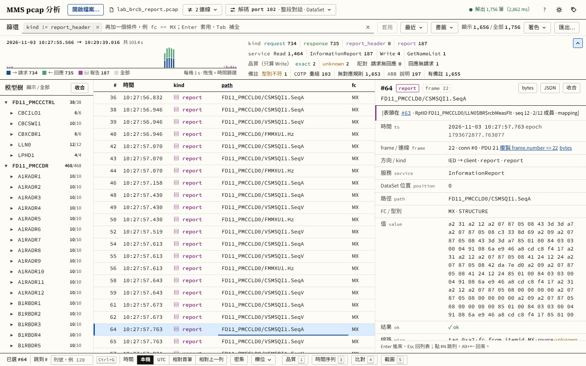 | 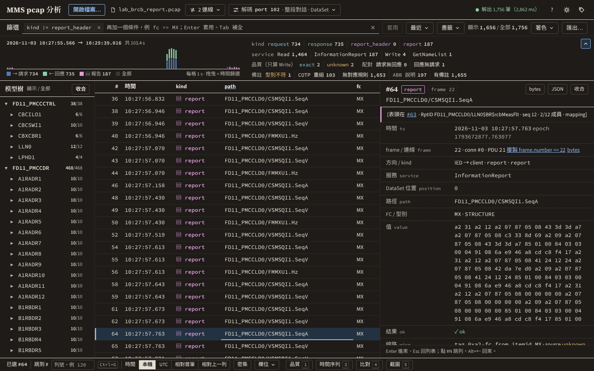 |

**設計理由**

- 像在讀排版好的技術文件：紙白底、黑字、細線分隔，表頭是上粗下細的三線表，沒有大色塊；標題（工具名、篩選、模型樹、#64、結構）用 Source Serif 4 / Noto Serif TC，介面 Source Sans 3，資料 Source Code Pro——同一個家族的三個成員。
- kind 不用左邊色條，改成 kind 欄文字套色（像印刷的套色），左邊留給選取列的 3 px 標記；總覽像報告裡的「圖 1 ＋摘要表」：直方圖坐在黑色基線上，計數是用細線隔開的表格欄。
- 截圖貼進報告或印出來最好看（`@media print` 去掉底色、選取列只留黑邊）；詳情欄放寬到 36%，欄位表行距加大、點線分隔，讀長結構不累。深色版是暖色「夜讀」，不是為投影設計。
- 不適合要最高密度或長時間監看的情境（列 30 px、留白多）。
- 跟現在差在：字型、三線表、kind 改文字色、篩選框改成底線式輸入、總覽計數改表格式、詳情更寬。

**字型**：Source Serif 4（標題）＋ Source Sans 3（介面）＋ Source Code Pro（資料）；中文標題 Noto Serif TC（OFL 1.1）。latin＋latin-ext 8 個 woff2 共 306 KB；Noto Serif TC 只給標題用，子集到標題用字。中文一律後備 Noto Sans TC → PingFang TC → Microsoft JhengHei；介面字串固定，可以用 pyftsubset 只留介面用字（主畫面 241 字實測每個字重 51 KB）。

**跟現在不一樣的元件**（完整寫法在 [style_directions_2026-11-09/css/C.css](style_directions_2026-11-09/css/C.css)）

- `.topbar .brand` 襯線 18 px；`.topbar` 底線是 1 px 黑線（報告頁首）；`.flabel`、`.tree-head` 標題、`.dh-id` 的 #64、`.detail h4` 用襯線。
- `.fbox` 去框，只留底線（填空式輸入）；`.fchip` 像文件裡的行內程式碼（淡灰底、2 px 圓角）。
- `.overview` 白底、底線黑；`.hist-plot` 無框、只有黑色基線；`.cnt` 無框無底，用左側細線分隔，像表格欄；`.clabel` 小一號灰字。
- `.hdr` 白底、下框 1.5 px 黑；`.hcell` 去掉直線；`.hbtn` 黑色粗體；`.row` kind 色條寬 0，`.row .c-kind` 依 kind 套色並加粗。
- `.row.sel` 淡藍底＋左側 3 px 標記；`.cell.active` 改底線；`.tnode.cur` 同樣用左側標記。
- `.pairing` 去底色，左側 3 px 報告色線；`.ftable th / td` 上下 5 px、點線分隔，巢狀表不畫線。
- `.segc button[aria-pressed=true]` 反白（黑底白字）；`.statusbar` 上框黑線。
- `path` 預設欄寬 360 → 320 px（JS；內容最長約 200 px），詳情放寬後 fc 欄才不會被切。

**顏色的意思**（kind、狀態、直方圖、6 條時間序列線、6 種著色規則底色、選取 / 滑過 / 篩選 chip / 焦點框 / 比對被改；上半淺色、下半深色）

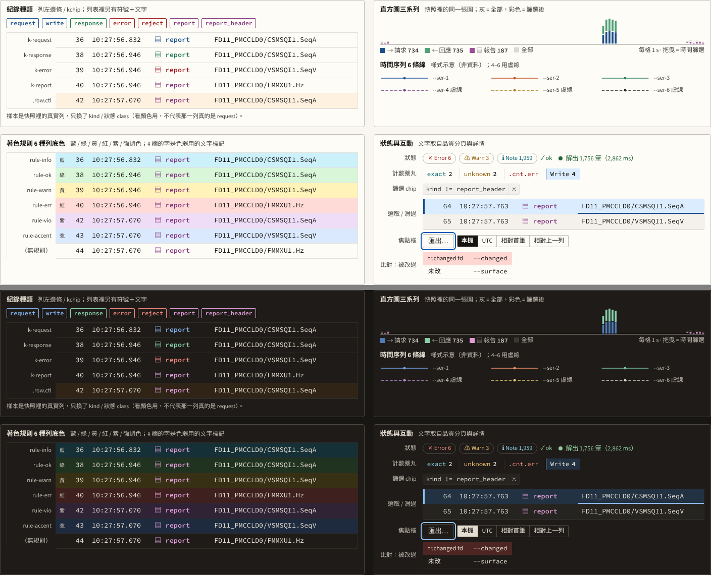

**完整變數**（版面變數只寫在 `:root`，深淺共用）

```css
:root {
  /* 字型 */
  --sans: "Source Sans 3", "Noto Sans TC", "PingFang TC", "Microsoft JhengHei", system-ui, sans-serif;
  --mono: "Source Code Pro", "Noto Sans TC", "PingFang TC", "Microsoft JhengHei", ui-monospace, monospace;
  --serif: "Source Serif 4", "Noto Serif TC", "PingFang TC", "Microsoft JhengHei", serif;
  /* 尺寸與版面（深淺共用） */
  --font-ui: 14px; --font-dense: 13.5px; --row-h: 30px; --h-top: 48px;
  --h-filter: 40px; --h-ov: 108px; --h-ovmini: 28px; --h-status: 32px;
  --h-bottom: 320px; --h-ctl: 28px; --h-ctl-sm: 24px; --h-chip: 22px;
  --h-node: 26px; --h-hist: 52px; --w-tree: 16%; --w-tree-min: 200px;
  --w-detail: 36%; --w-detail-min: 360px; --r: 3px; --r-sm: 2px;
  --r-lg: 4px; --u: 4px; --kind-bar: 0px; --font-chrome: 13.5px;
  --font-small: 12.5px;
  /* 表面 */
  --bg: #f9f6f2; --topbar: #fefcf7; --panel: #f7f5f1; --surface: #fefcf7;
  --surface2: #f2f0ec; --input: #ffffff; --border: #bfbdb9; --bsoft: #e3e1dd;
  --hover: #f4f1ed; --nav-hover: #f2f0ec; --nav-active: #dee9f5;
  /* 文字 */
  --text: #151411; --muted: #44423e; --dim: #55524c; --faint: #7d7a74;
  /* 強調 / 焦點 */
  --accent: #1e4b8d; --accent-solid: #184687; --accent-ink: #ffffff; --focus: #0958bb;
  /* 狀態 */
  --ok: #236436; --warn: #915c08; --err: #9e1618; --info: #0b6677;
  --vio: #703a86;
  /* 圖表 */
  --ch-req: #1d4d87; --ch-resp: #4f9f77; --ch-rpt: #9a4c95; --ch-ghost: #dbd9d5;
  --ser-1: #21539c; --ser-2: #c55123; --ser-3: #31835d; --ser-4: #723789;
  --ser-5: #a77f19; --ser-6: #23211f;
  /* 新增：紀錄種類 */
  --k-req: #154d8c; --k-resp: #1f744f; --k-err: #9e1618; --k-rpt: #81347c;
  /* 新增：列底色 */
  --ctl-bg: #fff1e0; --rule-info: #ccf1fa; --rule-ok: #d9f6d9; --rule-warn: #fff3b9;
  --rule-err: #ffdbd7; --rule-vio: #efddf7; --rule-accent: #dbe9ff; --sel-bg: #daecfe;
  --sel-edge: #154d8c; --changed: #fed7d3;
  --shadow-pop: 0 1px 0 #00000014, 0 6px 18px #0000001f;
}
:root[data-theme="dark"] {
  /* 表面 */
  --bg: #181612; --topbar: #1e1b18; --panel: #201e1a; --surface: #1e1b18;
  --surface2: #262420; --input: #161310; --border: #4a4743; --bsoft: #2e2b27;
  --hover: #262420; --nav-hover: #25221f; --nav-active: #262f38;
  /* 文字 */
  --text: #e3ddd1; --muted: #bfbab0; --dim: #aeaaa2; --faint: #7d7a74;
  /* 強調 / 焦點 */
  --accent: #90baf1; --accent-solid: #4772b1; --accent-ink: #ffffff; --focus: #93c1fc;
  /* 狀態 */
  --ok: #91cb9c; --warn: #edbf71; --err: #f2897e; --info: #88cada;
  --vio: #d0a4e4;
  /* 圖表 */
  --ch-req: #507cb5; --ch-resp: #89d0aa; --ch-rpt: #e39cd3; --ch-ghost: #3a3733;
  --ser-1: #74a7e8; --ser-2: #f59569; --ser-3: #77c4a3; --ser-4: #bf8fd4;
  --ser-5: #e6c873; --ser-6: #dad7d0;
  /* 新增：紀錄種類 */
  --k-req: #85b4f0; --k-resp: #8cd3ad; --k-err: #f2897e; --k-rpt: #df9ed9;
  /* 新增：列底色 */
  --ctl-bg: #2f2416; --rule-info: #153036; --rule-ok: #203220; --rule-warn: #373014;
  --rule-err: #3e211f; --rule-vio: #302336; --rule-accent: #1e2a3e; --sel-bg: #233242;
  --sel-edge: #8bbcef; --changed: #4d2623;
  --shadow-pop: 0 1px 0 #0000004d, 0 6px 18px #00000066;
}
.app[data-density=dense] { --row-h: 24px; --font-dense: 13px; }
```

## §5 D 現代產品感

| 淺色 | 深色 |
|---|---|
| 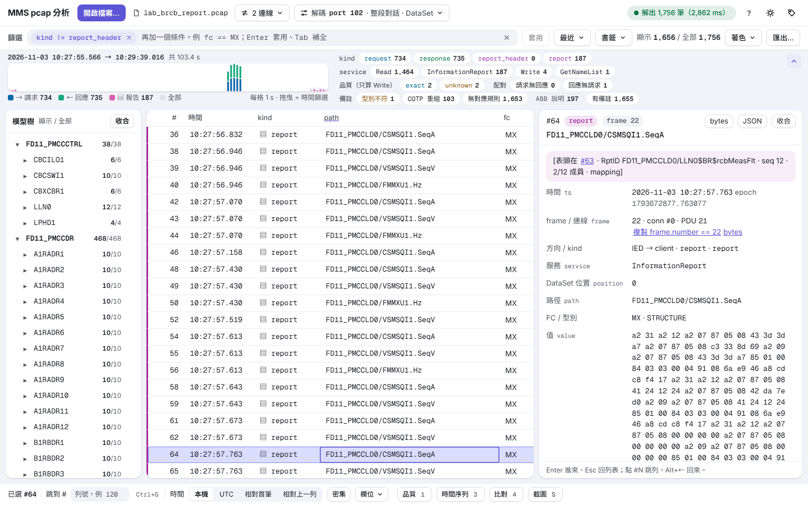 | 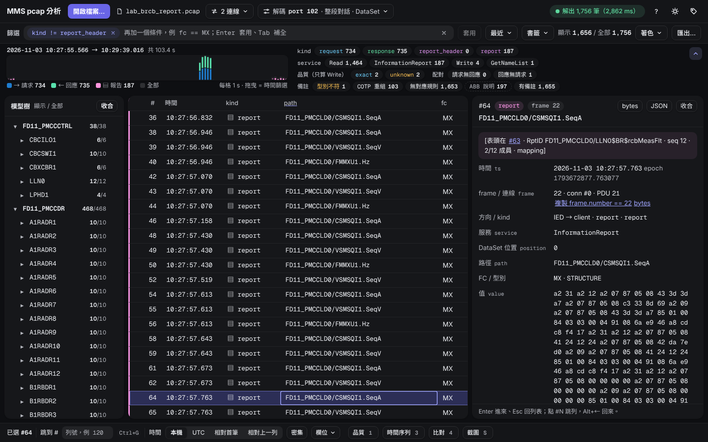 |

**設計理由**

- 柔和的表面層次：淡灰底上浮著三張圓角 12 px 的卡片（模型樹 / 列表 / 詳情），卡片間距 10 px，只用很淡的陰影分層，幾乎不用框線。
- 主要動作清楚：「開啟檔案…」是唯一的實心靛藍按鈕；狀態是柔和色塊（「解出 1,756 筆」＝淡綠藥丸）；篩選列像搜尋框（圓角、灰底、聚焦變白），chip、計數、kchip 都是膠囊。
- 密度只比現在低一點：列高 30 px（現在 32），表頭仍從 y = 196 開始，可見 20 列（同現在）；Inter 在 13.5 px 好讀，Geist Mono 數字等寬。
- 適合新手、展示、對外場合；不適合要最大密度，或截圖要很樸素的報告（陰影和圓角在 A4 上顯得花）。
- 跟現在差在：卡片化、實心主要按鈕、膠囊 chip / 計數、分段控制改成滑塊式、表格去掉直線。

**字型**：Inter（介面）＋ Geist Mono（資料）（OFL 1.1）。latin＋latin-ext 7 個 woff2 共 285 KB。中文一律後備 Noto Sans TC → PingFang TC → Microsoft JhengHei；介面字串固定，可以用 pyftsubset 只留介面用字（主畫面 241 字實測每個字重 51 KB）。

**跟現在不一樣的元件**（完整寫法在 [style_directions_2026-11-09/css/D.css](style_directions_2026-11-09/css/D.css)）

- `.workspace` 加 10 px 內距與間距；`.treepane`、`.listwrap`、`.detail` 變卡片（12 px 圓角、`--shadow-card`、無框）。
- `.topbar`、`.filterbar` 白底，只用 1 px 陰影線分隔；`.tbtn` 30 px、8 px 圓角、`--shadow-xs`；`.tbtn.out` 實心 `--accent-solid`；`.tbtn.ib` 透明。
- `.fbox` 10 px 圓角灰底無框；`.fchip` 膠囊（強調色 14% 底、強調色字、無框）。
- `.overview` 與底色同色；`.hist-plot` 變小卡片；`.cnt` 20 px 膠囊、白底、`--shadow-xs`；`.cnt[aria-pressed=true]` 強調色淡底＋內框。
- `.hcell` 去掉直線；`.hbtn` 500 字重灰字；`.cell` 左右 10 px；`.row.sel` 靛藍淡底＋半透明內框；`.cell.active` 4 px 圓角框。
- `.tnode` 左右內縮 6 px、6 px 圓角，`.tnode.cur` 靛藍淡底、名稱強調色。
- `.kchip` 膠囊，依 kind 給 13% 淡底；`.pairing` 變成圓角說明卡；`.ftable` 去掉框線，只在列之間留細線。
- `.segc` 灰色軌道＋白色滑塊（`button[aria-pressed=true]`）；`.statusbar .jump` 灰底圓角；`kbd` 無框。
- `path` 預設欄寬 360 → 320 px（同 C）。

**顏色的意思**（kind、狀態、直方圖、6 條時間序列線、6 種著色規則底色、選取 / 滑過 / 篩選 chip / 焦點框 / 比對被改；上半淺色、下半深色）

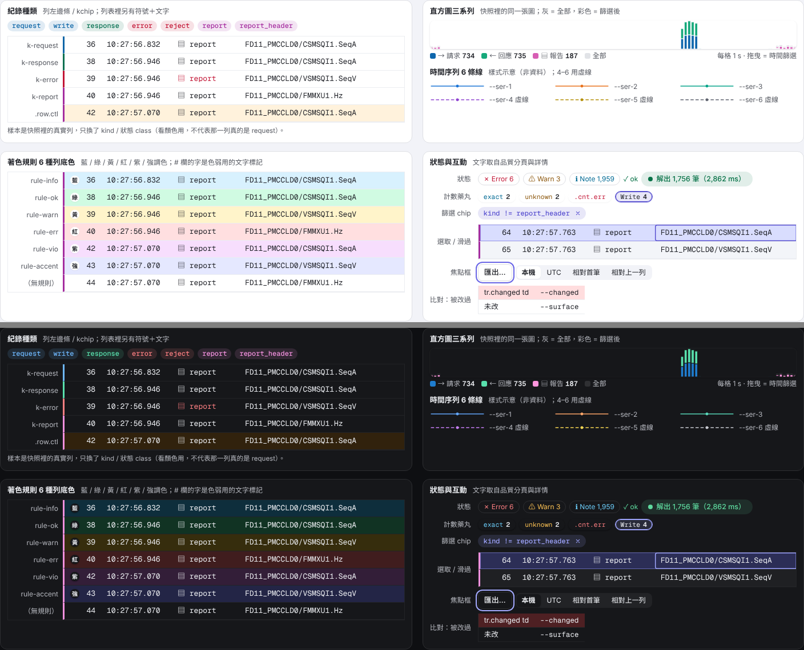

**完整變數**（版面變數只寫在 `:root`，深淺共用）

```css
:root {
  /* 字型 */
  --sans: "Inter", "Noto Sans TC", "PingFang TC", "Microsoft JhengHei", system-ui, sans-serif;
  --mono: "Geist Mono", "Noto Sans TC", "PingFang TC", "Microsoft JhengHei", ui-monospace, monospace;
  /* 尺寸與版面（深淺共用） */
  --font-ui: 13.5px; --font-dense: 13px; --row-h: 30px; --h-top: 46px;
  --h-filter: 42px; --h-ov: 100px; --h-ovmini: 30px; --h-status: 38px;
  --h-bottom: 300px; --h-ctl: 30px; --h-ctl-sm: 26px; --h-chip: 22px;
  --h-node: 28px; --h-hist: 50px; --w-tree: 17%; --w-tree-min: 200px;
  --w-detail: 33%; --w-detail-min: 340px; --r: 8px; --r-sm: 6px;
  --r-lg: 12px; --u: 4px; --kind-bar: 3px; --font-chrome: 13px;
  --font-small: 12px;
  /* 表面 */
  --bg: #f2f3f8; --topbar: #ffffff; --panel: #f8fafe; --surface: #ffffff;
  --surface2: #f2f3f8; --input: #ffffff; --border: #dedfe4; --bsoft: #ebedf1;
  --hover: #f3f5f9; --nav-hover: #f1f2f7; --nav-active: #e9ebfe;
  /* 文字 */
  --text: #1d1f25; --muted: #555860; --dim: #5f626c; --faint: #8f929a;
  /* 強調 / 焦點 */
  --accent: #5850d0; --accent-solid: #5c55d5; --accent-ink: #ffffff; --focus: #6965e6;
  /* 狀態 */
  --ok: #067146; --warn: #8c570d; --err: #c21535; --info: #026a94;
  --vio: #9738ac;
  /* 圖表 */
  --ch-req: #0e66ac; --ch-resp: #16a97b; --ch-rpt: #d75eb4; --ch-ghost: #e1e3e7;
  --ser-1: #1a73d5; --ser-2: #e8721c; --ser-3: #05a388; --ser-4: #8f43d1;
  --ser-5: #b59008; --ser-6: #5f636f;
  /* 新增：紀錄種類 */
  --k-req: #0d66a7; --k-resp: #057051; --k-err: #c21535; --k-rpt: #a52d9f;
  /* 新增：列底色 */
  --ctl-bg: #fff2dc; --rule-info: #d8f1fe; --rule-ok: #d0fbe2; --rule-warn: #fff4ca;
  --rule-err: #ffdfe0; --rule-vio: #f7defd; --rule-accent: #e5e8ff; --sel-bg: #d9ddfe;
  --sel-edge: #645fdf; --changed: #ffddde;
  --shadow-xs: 0 1px 2px #1018280d;
  --shadow-card: 0 1px 2px #1018280f, 0 1px 3px #1018281a;
  --shadow-pop: 0 4px 6px -2px #10182808, 0 12px 16px -4px #10182814;
}
:root[data-theme="dark"] {
  /* 表面 */
  --bg: #0e0f12; --topbar: #141518; --panel: #1b1c1f; --surface: #16171a;
  --surface2: #222326; --input: #121315; --border: #2d2e31; --bsoft: #222326;
  --hover: #1f2023; --nav-hover: #1e1f22; --nav-active: #292b46;
  /* 文字 */
  --text: #e9ebef; --muted: #b5b7be; --dim: #a8abb3; --faint: #6f7178;
  /* 強調 / 焦點 */
  --accent: #9ea4fc; --accent-solid: #6965e6; --accent-ink: #ffffff; --focus: #a2a8fd;
  /* 狀態 */
  --ok: #5ed99e; --warn: #fac053; --err: #fc7f82; --info: #6bcbf7;
  --vio: #db90ec;
  /* 圖表 */
  --ch-req: #1f7dcf; --ch-resp: #59e0ad; --ch-rpt: #fd95dc; --ch-ghost: #2f3033;
  --ser-1: #63a7fc; --ser-2: #fda669; --ser-3: #59d7b9; --ser-4: #c780f7;
  --ser-5: #f6d653; --ser-6: #c8cad1;
  /* 新增：紀錄種類 */
  --k-req: #6eb7fc; --k-resp: #59e0ad; --k-err: #fc7f82; --k-rpt: #f190dd;
  /* 新增：列底色 */
  --ctl-bg: #31220d; --rule-info: #0e2e3c; --rule-ok: #113323; --rule-warn: #362d0d;
  --rule-err: #401d1e; --rule-vio: #331e38; --rule-accent: #232546; --sel-bg: #2c2e56;
  --sel-edge: #8d92f9; --changed: #4e2023;
  --shadow-xs: 0 1px 2px #00000066;
  --shadow-card: 0 0 0 1px #ffffff0d, 0 1px 3px #00000080;
  --shadow-pop: 0 0 0 1px #ffffff14, 0 12px 24px #000000b3;
}
.app[data-density=dense] { --row-h: 24px; --font-dense: 12.5px; }
```

## §6 E 高對比（戶外 / 投影 / 低視力）

| 淺色 | 深色 |
|---|---|
| 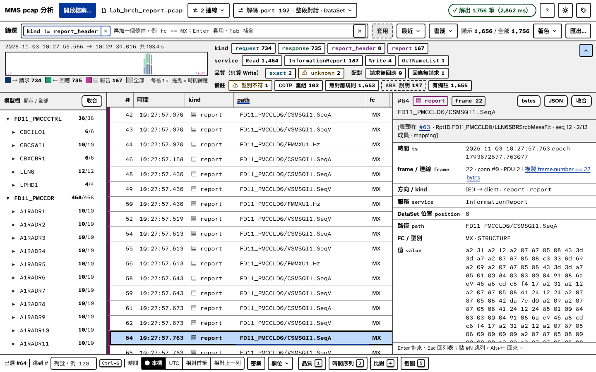 | 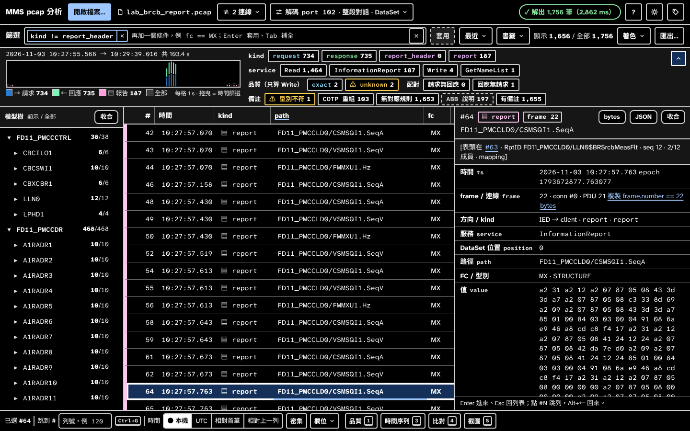 |

**設計理由**

- 所有文字對背景 ≥ 7:1（實際渲染量到的最低：淺色 8.9:1、深色 10.4:1；狀態 / kind 色當文字 ≥ 7.0:1）；淺色純白底黑字、深色純黑底白字，框線 2 px。
- 焦點框 3 px ＋ 2 px 間隔＋外圈（淺色深藍、深色黃色）；按鈕 36 px、工具列按鈕 32 px、樹列 32 px、列表列 36 px，點擊範圍都 ≥ 32 px。
- 色彩之外一定有形狀或文字：kchip 前加 → ← ▤ ✗；警告計數與詳情的警告加 ⚠；狀態藥丸加 ✓；選中的時間格式加 ●；著色規則列在 # 欄加「藍 / 綠 …」字；控制列加斜紋，fc 加底線；停用的「套用」改虛線框而不是半透明。
- 代價：表頭起點 y = 224，比 196 低 28 px，可見列 20 → 16；換到的是 15 px 字、36 px 點擊範圍、AAA 對比。適合戶外、投影、低視力；不適合日常大量瀏覽——建議做成第三個主題，跟 A–D 任一並存。
- 1280 寬時三條都不折行；只有直方圖圖例右邊的提示「每格 1 s · 拖曳 = 時間篩選」會用 … 截斷（不壓到旁邊的計數）。

**字型**：Atkinson Hyperlegible Next ＋ Atkinson Hyperlegible Mono（Braille Institute 為低視力讀者設計）（OFL 1.1）。latin＋latin-ext 8 個 woff2 共 143 KB。中文一律後備 Noto Sans TC → PingFang TC → Microsoft JhengHei；介面字串固定，可以用 pyftsubset 只留介面用字（主畫面 241 字實測每個字重 51 KB）。

**跟現在不一樣的元件**（完整寫法在 [style_directions_2026-11-09/css/E.css](style_directions_2026-11-09/css/E.css)）

- `:focus-visible` 3 px ＋ 2 px 間隔＋外圈 `--focus-halo`；`.fbox:focus-within` 同樣 3 px；`a`、`.link`、`.ref` 底線 2 px。
- `.tbtn` 2 px 框、600 字重；`.tbtn.out` 實心；`.tbtn:disabled` 改虛線框＋灰底（不再半透明）。
- `.pill` 2 px 框、粗體，`.dot` 換成 ✓ / … / ✗ 字；`.cnt` 2 px 框，`.cnt.warn` 加 ⚠、`.cnt.err` 加 ✗，`.cnt.static` 虛線框；`.q-pill` 2 px 框。
- `.treepane`、`.listwrap` 右框 2 px；`.hdr`、`.tree-head`、`.detail-head` 下框 2 px；`.hbtn` 800 字重黑字。
- `.row.sel` 3 px 黑（深色版白）框＋粗體；`.vlist:focus-visible .row.sel` 換成 3 px 焦點色框；kind 色條 6 px；`.cell.active` 3 px 底線。
- `.kchip` 2 px 框並加 kind 符號；`.detail .warn` 加 ⚠；`.segc button[aria-pressed=true]` 反白並加 ●；`kbd` 2 px 框。
- `.row.ctl` 斜紋＋ `.c-fc` 粗體底線；著色規則列在 `.c-row` 前加規則名稱方框。
- `path` 預設欄寬 360 → 320 px（同 C）。

**顏色的意思**（kind、狀態、直方圖、6 條時間序列線、6 種著色規則底色、選取 / 滑過 / 篩選 chip / 焦點框 / 比對被改；上半淺色、下半深色）

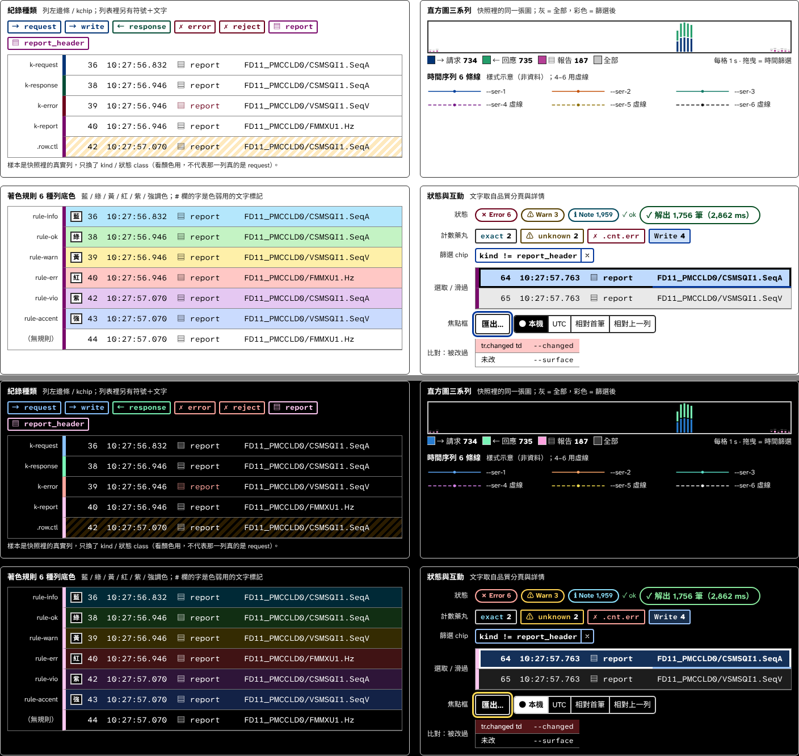

**完整變數**（版面變數只寫在 `:root`，深淺共用）

```css
:root {
  /* 字型 */
  --sans: "Atkinson Hyperlegible Next", "Noto Sans TC", "PingFang TC", "Microsoft JhengHei", system-ui, sans-serif;
  --mono: "Atkinson Hyperlegible Mono", "Noto Sans TC", "PingFang TC", "Microsoft JhengHei", ui-monospace, monospace;
  /* 尺寸與版面（深淺共用） */
  --font-ui: 15px; --font-dense: 14px; --row-h: 36px; --h-top: 52px;
  --h-filter: 48px; --h-ov: 124px; --h-ovmini: 36px; --h-status: 44px;
  --h-bottom: 320px; --h-ctl: 36px; --h-ctl-sm: 32px; --h-chip: 26px;
  --h-node: 32px; --h-hist: 58px; --w-tree: 18%; --w-tree-min: 210px;
  --w-detail: 34%; --w-detail-min: 360px; --r: 4px; --r-sm: 3px;
  --r-lg: 6px; --u: 4px; --kind-bar: 6px; --font-chrome: 14px;
  --font-small: 13px;
  /* 表面 */
  --bg: #ffffff; --topbar: #ffffff; --panel: #f0f0f0; --surface: #ffffff;
  --surface2: #e9e9e9; --input: #ffffff; --border: #2e2e2e; --bsoft: #868686;
  --hover: #e9e9e9; --nav-hover: #e9e9e9; --nav-active: #cde0f9;
  /* 文字 */
  --text: #000000; --muted: #1f1f1f; --dim: #292929; --faint: #555555;
  /* 強調 / 焦點 */
  --accent: #02369b; --accent-solid: #02369b; --accent-ink: #ffffff; --focus: #02369b;
  /* 狀態 */
  --ok: #054d21; --warn: #553e01; --err: #6d011b; --info: #02485c;
  --vio: #631778;
  /* 圖表 */
  --ch-req: #033475; --ch-resp: #239d6a; --ch-rpt: #b53e95; --ch-ghost: #c4c4c4;
  --ser-1: #01409c; --ser-2: #c4530b; --ser-3: #107a66; --ser-4: #751888;
  --ser-5: #8e7002; --ser-6: #161616;
  /* 新增：紀錄種類 */
  --k-req: #013476; --k-resp: #044c36; --k-err: #6d011b; --k-rpt: #790a6b;
  /* 新增：列底色 */
  --ctl-bg: #fee9be; --rule-info: #b4e7fc; --rule-ok: #c4f3c4; --rule-warn: #fef0a9;
  --rule-err: #ffc8c5; --rule-vio: #e5c8f2; --rule-accent: #cadbfe; --sel-bg: #bfdafd;
  --sel-edge: #000000; --changed: #fec8c7;
  --focus-halo: #ffffff;
  --shadow-pop: 0 0 0 2px #000000;
}
:root[data-theme="dark"] {
  /* 表面 */
  --bg: #000000; --topbar: #000000; --panel: #161616; --surface: #000000;
  --surface2: #1f1f1f; --input: #000000; --border: #cecece; --bsoft: #717171;
  --hover: #1d1d1d; --nav-hover: #1d1d1d; --nav-active: #182e4b;
  /* 文字 */
  --text: #ffffff; --muted: #e8e8e8; --dim: #dedede; --faint: #9e9e9e;
  /* 強調 / 焦點 */
  --accent: #9dc7fe; --accent-solid: #9dc7fe; --accent-ink: #000000; --focus: #fedc55;
  /* 狀態 */
  --ok: #89eb9f; --warn: #fed252; --err: #fea69e; --info: #8bdffa;
  --vio: #e9b4f9;
  /* 圖表 */
  --ch-req: #287ccf; --ch-resp: #7af4b7; --ch-rpt: #fda1df; --ch-ghost: #3d3d3d;
  --ser-1: #5ea8f9; --ser-2: #fea668; --ser-3: #5addc7; --ser-4: #d984ed;
  --ser-5: #f7e04f; --ser-6: #f2f2f2;
  /* 新增：紀錄種類 */
  --k-req: #89c3ff; --k-resp: #7af4b7; --k-err: #fea69e; --k-rpt: #fdc7f0;
  /* 新增：列底色 */
  --ctl-bg: #2b1c00; --rule-info: #002936; --rule-ok: #112e13; --rule-warn: #342b02;
  --rule-err: #401314; --rule-vio: #2e1538; --rule-accent: #132246; --sel-bg: #143058;
  --sel-edge: #ffffff; --changed: #521518;
  --focus-halo: #000000;
  --shadow-pop: 0 0 0 2px #ffffff;
}
.app[data-density=dense] { --row-h: 30px; --font-dense: 13.5px; }
```

## §7 現況的色票（對照用）

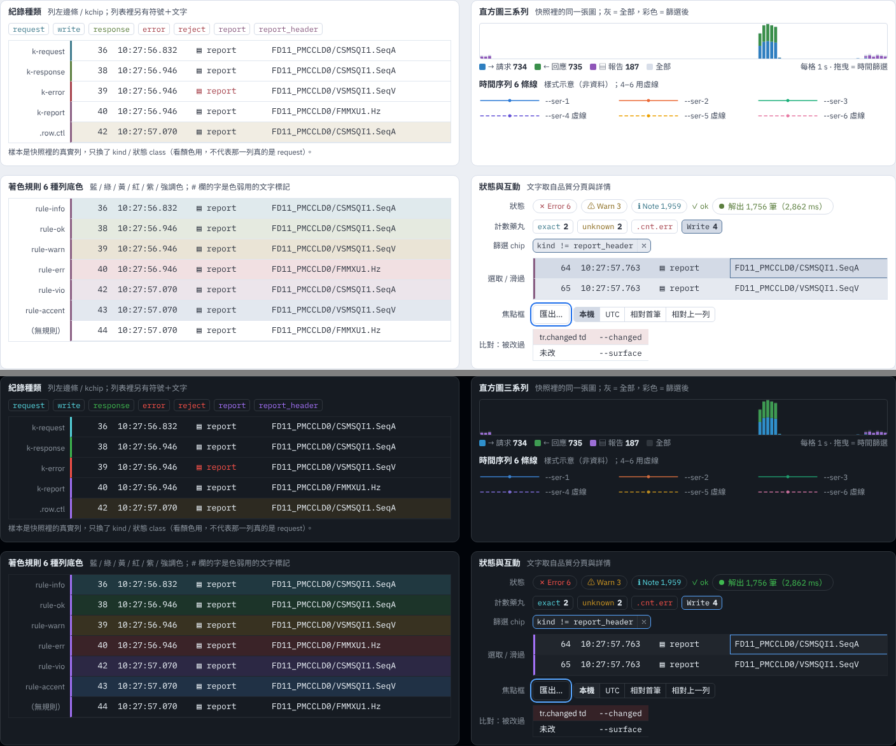

## §8 驗證 / Checks

對比是 WCAG 2.x 對比比值；ΔE 是 CIEDE2000，色弱用 Machado 2009（嚴重度 1.0）模擬紅色盲、綠色盲、藍色盲，取三者中最差的一對。「DOM 實測」是把每張主畫面渲染後，逐一量畫面上每段可見文字對它實際背景（含半透明底色合成）的對比，停用的按鈕（「套用」）不算。

| | 文字最低 | 狀態 / kind 當文字 | 焦點框 | 直方圖 | 時間序列 | 直方圖三色·色弱 ΔE | 時間序列實線組 / 虛線組·色弱 ΔE | 6 種列底色 ΔE（一般 / 色弱） | DOM 實測文字最低 |
|---|---|---|---|---|---|---|---|---|---|
| 現況 淺 | 4.05 | 3.32 | 3.3 | 4.03 | 2.17 | 2.0 | 14.6 / 8.2 | 2.9 / 0.6 | 4.04 |
| 現況 深 | 2.67 | 4.54 | 6.03 | 4.66 | 3.95 | 1.6 | 9.1 / 8.3 | 9.4 / 1.0 | 3.77 |
| A 淺 | 4.74 | 4.51 | 3.25 | 3.01 | 3.35 | 7.7 | 14.5 / 10.0 | 11.5 / 1.9 | 5.68 |
| A 深 | 4.52 | 4.5 | 4.97 | 3.92 | 5.95 | 8.1 | 8.8 / 8.8 | 12.7 / 1.5 | 6.33 |
| B 淺 | 4.99 | 4.51 | 3.65 | 3.0 | 3.55 | 15.2 | 13.5 / 18.2 | 9.9 / 0.5 | 4.52 |
| B 深 | 5.14 | 4.74 | 5.91 | 4.23 | 6.78 | 15.7 | 9.4 / 17.5 | 10.3 / 1.3 | 5.91 |
| C 淺 | 6.06 | 4.66 | 5.57 | 3.12 | 3.6 | 6.1 | 12.8 / 22.9 | 10.8 / 1.0 | 5.48 |
| C 深 | 5.65 | 5.39 | 7.02 | 3.99 | 6.61 | 15.2 | 7.9 / 15.0 | 11.9 / 0.7 | 6.24 |
| D 淺 | 4.56 | 4.5 | 3.41 | 3.0 | 3.02 | 8.4 | 13.0 / 20.1 | 10.5 / 0.5 | 4.94 |
| D 深 | 5.6 | 5.21 | 5.85 | 4.18 | 6.71 | 15.2 | 10.9 / 20.1 | 8.9 / 1.3 | 4.56 |
| E 淺 | 9.61 | 7.01 | 7.32 | 3.44 | 4.58 | 13.1 | 16.4 / 20.3 | 12.7 / 1.5 | 8.91 |
| E 深 | 9.8 | 7.01 | 9.78 | 4.87 | 8.44 | 18.1 | 11.6 / 16.8 | 12.2 / 0.5 | 10.37 |

讀法：
- 門檻：文字 ≥ 4.5（E ≥ 7）；狀態 / kind 色因為也拿來當文字（kchip、計數、`.warn`），這裡用 4.5（E 用 7）檢查，比 prompt 要求的 3:1 嚴；焦點框、直方圖、時間序列 ≥ 3。五個方向全部過；現況有 4 格不過（淺色文字、深色文字、淺色狀態當文字、淺色時間序列），DOM 實測兩個主題也都低於 4.5。
- 時間序列 6 條線不追求兩兩都分得開：1–3 號實線、4–6 號虛線，組內色弱 ΔE ≥ 7.9。
- 6 種著色規則底色是淡色，色弱下本來就分不開（0.5–1.9），所以加了 # 欄的文字標記（§1.2）。
- kind、狀態在色弱下有幾對偏近（kind 最低 1.9，E 淺色的 request / report），列表本身有符號＋文字（→ ← ▤ 與 kind 名稱），E 另在 kchip 加符號。
- console 錯誤：所有渲染 0 個。

## §9 第二輪要準備的 / For round 2

- 剩下 4 張附件（06 bytes、07 空白頁＋解碼面板、08 比對、09 匯出對話框）第二輪才用得到，屆時再給。
- 比截圖更好用的是**那些狀態的靜態快照**（跟 `snapshot_main.html` 同一個做法：DOM＋全部 CSS）：bytes 檢視、解碼面板、時間序列、品質、比對、匯出、著色規則、右鍵選單、快捷鍵、拖放提示、port 錯誤卡。有快照就能像這一輪一樣直接套 CSS 渲染真畫面，而不是照截圖重畫。`scripts/pcap_web_design_capture.py` 加幾個狀態應該就能產。
- 第二輪 prompt 照 [style_prompt_2026-11-09](style_prompt_2026-11-09.md) §2 填。

## §10 檔案 / Files

| 路徑 | 內容 |
|---|---|
| `shots/style_directions_2026-11-09/overview.png` | 總覽：現況＋五個方向，上排淺色、下排深色 |
| `shots/style_directions_2026-11-09/{A..E}_{light,dark}.png` | 主畫面 1440 × 900 |
| `shots/style_directions_2026-11-09/{A..E}_1280.png` | 1280 × 800 淺色，檢查頂欄 / 篩選列 / 工具列不折行 |
| `shots/style_directions_2026-11-09/swatch_{A..E,current}.png` | 色票（淺色在上、深色在下） |
| `style_directions_2026-11-09/css/_v2_layer.css` | 共用層：寫死的數字 → 變數（預設 = 現況） |
| `style_directions_2026-11-09/css/_v2_fixes.css` | 共用修正（§1.2） |
| `style_directions_2026-11-09/css/{A..E}.css` | 各方向完整 CSS：`:root`、`:root[data-theme="dark"]`、元件樣式 |
| `style_directions_2026-11-09/checks/` | 檢查結果：`token_summary.json`（變數配對）、`audit_summary.json`（DOM 實測）、`render_metrics.txt` |
| `style_directions_2026-11-09/tools/` | 產圖與檢查腳本，見裡面的 README |
| `shots/style_input_2026-11-09/` | 這一輪的輸入：`snapshot_main.html`、`info.json` |

套用順序：app.css → `_v2_layer.css` → `_v2_fixes.css` → 方向 CSS。落地時把 v2 兩層併進 app.css、方向的兩段變數取代 tokens.css（`@media (prefers-color-scheme: dark)` 那段照深色段複製）。
