# 頂部重設計：研究與三個方案（2026-11-09）

> 📘 **REFERENCE** ｜ **日期**：2026-11-09 ｜ **用途**：使用者回饋「頂欄屬性按鈕太多很雜」。研究同類 web 工具怎麼安排頂部，重新設計頂欄＋篩選列；底部工具列順帶整理，因為有幾個功能要搬過去。
> **怎麼做的**：跟[風格第一輪](style_directions_2026-11-09.md)一樣，拿 `snapshot_main.html` 的真實 DOM，用腳本把**現有的元素搬到新位置**（不重畫、不編資料），用**現在的配色**渲染，只比版面；任何風格方向（A–E）都能套，附一張套 B 的示意。
> **沒有砍功能**：每個控制項與快捷鍵搬到哪裡見 §6；解碼面板、連線表、最近、書籤、著色規則、欄位、匯出這些彈出層的內容都不變，只換入口。

## §0 結論 / Summary

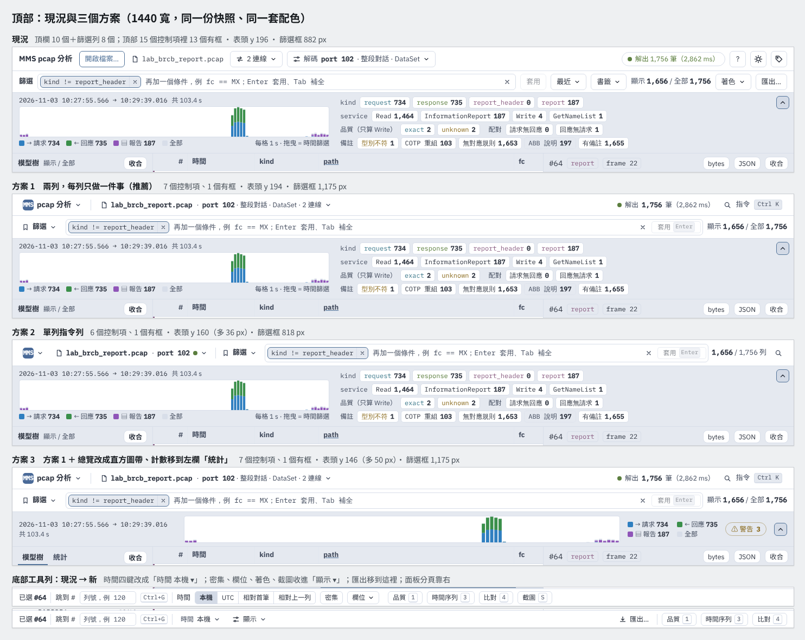

| | 現況 | 方案 1 兩列（推薦） | 方案 2 單列 | 方案 3 方案 1＋總覽瘦身 |
|---|---|---|---|---|
| 頂部可見控制項（有框的） | 15（13） | 7（1） | 6（1） | 7（1） |
| 表頭起點 y（1440 × 900） | 196 | 194 | 160（多 36 px） | 146（多 50 px） |
| 篩選框寬度 px（1280 / 1440 / 1920） | 722 / 882 / 1,362 | 1,015 / 1,175 / 1,655 | 658 / 818 / 1,298 | 1,015 / 1,175 / 1,655 |
| 1280 / 1920 寬折行或被切 | 無 | 無 | 無 | 無 |

**建議：先做方案 1。** 它直接解決「屬性按鈕太多」：檔名、連線、解碼、解析狀態這 4 個描述**同一個檔案**的按鈕併成一個「來源」晶片；品牌、開啟檔案、快捷鍵、主題、版本併成一個選單；篩選列只剩查詢本身，篩選框反而比現在寬 293 px。頂部從 15 個控制項（13 個有框）變成 7 個（只有篩選框有框），表頭位置不變。
**要更多列再做方案 3**：上面同方案 1，把總覽帶的 18 個計數藥丸移到左欄「統計」分頁（Kibana / Datadog 的 facet 做法），總覽只留一條直方圖，表頭再上移 48 px。方案 2 省垂直空間，但篩選框比現在窄，寫長條件時吃虧，只建議當備案。

## §1 現況哪裡雜 / Diagnosis

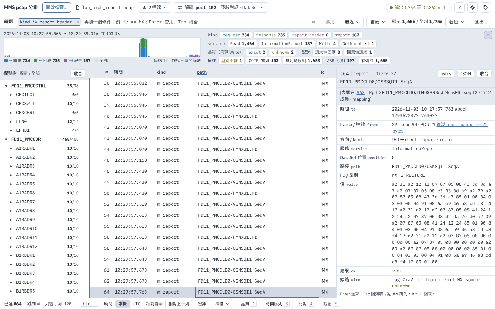

- **15 個控制項、13 個有框，大小和框都一樣**：沒有主次，眼睛找不到「這頁的主角是篩選」。
- **頂欄混了五種東西**：識別（工具名）、檔案動作（開啟檔案）、**這個檔案的屬性**（檔名、2 連線、解碼 port 102 · 整段對話 · DataSet、解出 1,756 筆）、應用程式設定（快捷鍵、主題、版本）。其中「屬性」佔了 4 個按鈕，但它們描述的是同一個東西。
- **篩選列也混了三種**：查詢（套用、最近、書籤）、檢視（著色）、輸出（匯出）。
- **底部工具列也擠**：時間格式用 4 個按鈕，密集、欄位、截圖各一個，跟 3 個面板分頁排在一起。

## §2 研究：同類工具怎麼放 / Research

看了 6 個封包 / 鑑識工具、5 個日誌與開發工具，加上 4 套設計系統的工具列規則。大多數讀的是官方文件（部分官網被這個環境的網路擋住，改讀它們放在 GitHub 的文件原始檔或程式碼，連結指向對應的公開頁）；只在搜尋摘要看到、沒讀到原文的標「未驗證」。

### 2.1 封包 / 鑑識工具

| 工具 | 篩選怎麼放 | 檔案、解碼、連線、設定放哪 | 計數與狀態 |
|---|---|---|---|
| **Wireshark**（使用者的參考）[文件](https://github.com/wireshark/wireshark/blob/master/doc/wsug_src/wsug_use.adoc) | 篩選工具列依序：書籤（存過的篩選）→ 輸入框 → 清除 → 套用 → 最近 → 「+」快捷篩選；在任何地方打字就開始寫篩選 | Decode As、Conversations、Capture File Properties、Coloring Rules、About 全在**選單**，不在工具列；主工具列可以整條藏起來 | **狀態列**：左邊 expert 等級圖示＋檔名，中間 Packets / Displayed（Marked、Dropped 有值才出現），右邊 profile |
| **Arkime** [說明頁](https://github.com/arkime/arkime/blob/main/viewer/vueapp/src/components/help/Help.vue)、[導覽列](https://github.com/arkime/arkime/blob/main/viewer/vueapp/src/components/utils/Navbar.vue) | 一列：運算式＋Search；旁邊「存成 View」與 Views 下拉；Actions 下拉做匯出 PCAP / CSV、加標籤 | 連線、歷史是獨立頁面；主題、快捷鍵在 Settings；「?」顯示快捷鍵 | 時間範圍與分頁在查詢列下方 |
| **Zui**（原 Brim）[README](https://github.com/brimdata/zui/blob/main/README.md)、[原始碼](https://github.com/brimdata/zui/tree/main/apps/superdb-desktop/src) | 「可釘選的查詢片段，讓搜尋框保持乾淨」：資料來源（pool）和時間範圍也做成 pin；工具列圖示放不下就收進「more」 | 側欄放 Pools、查詢庫、Sessions；歷史在右側面板 | 結果下方的 footer 放列數、總數 |
| **CloudShark**（未驗證）[profile](https://support.qacafe.com/cloudshark/user-guide/profiles)、[4.0](https://support.qacafe.com/cloudshark/release-notes/cloudshark-4-0-0/) | 篩選框旁一個「Filters」按鈕放存過的篩選 | 一個 Profile 一次帶 Decode As、協定偏好、存過的篩選、著色規則；File Info 彈窗放檔名、數量、大小、hash | 4.0 起狀態列放檔案統計與符合篩選的比例 |
| **Security Onion Hunt** [文件](https://github.com/Security-Onion-Solutions/securityonion-docs/blob/2.4/dashboards.rst) | 查詢列帶預設清單下拉，已套用的條件是框下方可移除的 bubble | 選項收在上方一個 Options 選單 | 時間選擇器在右上 |
| **Termshark** [使用手冊](https://github.com/gcla/termshark/blob/master/docs/UserGuide.md) | 紅 / 綠即時檢查＋Apply | Analysis 選單（檔案屬性、對話）；「:」指令列處理篩選歷史、主題、說明 | — |

### 2.2 日誌、觀測與開發工具

- **Kibana Discover 9.x**：上方 app 選單（New、Open、Share、Alert、Inspect、Save；Export 收在「… More」）；下一列是查詢列：data view 選擇器＋KQL 框（框左側一個 Query menu：存 / 載入查詢）＋時間＋Refresh；左側欄位清單點了看前 10 名的值與筆數；表格工具列的「Display options」收密度、列線、樣本數。[入門](https://www.elastic.co/docs/explore-analyze/discover/discover-get-started)、[篩選](https://www.elastic.co/docs/explore-analyze/query-filter/filtering)、[Document explorer](https://www.elastic.co/docs/explore-analyze/discover/document-explorer)
- **Grafana Explore**：工具列左上 data source 選擇器，右上時間＋Run query；查詢歷史是底部面板（History / Starred）；日誌的時間格式、換行、字級、下載放在結果旁一條可收合的控制列。[入門](https://grafana.com/docs/grafana/latest/visualizations/explore/get-started-with-explore/)、[查詢管理](https://grafana.com/docs/grafana/latest/visualizations/explore/query-management/)、[日誌](https://grafana.com/docs/grafana/latest/visualizations/explore/logs-integration/)
- **Datadog Log Explorer**：搜尋框的自動完成合併欄位值、最近 100 筆搜尋與 Saved Views；左側 facet 清單帶筆數；「Options」按鈕管每筆的高度與顯示；Saved Views 在左上。[搜尋](https://docs.datadoghq.com/logs/explorer/search/)、[facets](https://docs.datadoghq.com/logs/explorer/facets/)、[顯示](https://docs.datadoghq.com/logs/explorer/visualize/)
- **Chrome DevTools Network**：篩選列＝文字框＋Invert＋「More filters」（有數量徽章）＋類型 chip；不常用的 4 個勾選收進最右邊的齒輪；底部摘要列放「N / M requests」等數字。[參考](https://developer.chrome.com/docs/devtools/network/reference)
- **VS Code UX 準則**：狀態列「限制項目數」、用短文字標籤，整個工作區的放左邊、跟目前內容有關的放右邊；Command Palette 是「所有指令都找得到的地方」；次要動作收進「…」。[狀態列](https://code.visualstudio.com/api/ux-guidelines/status-bar)、[指令面板](https://code.visualstudio.com/api/ux-guidelines/command-palette)

### 2.3 設計系統給的數字

- **Fluent UI CommandBar**：一列「不要超過 5–7 個指令」，依重要性排，少用的進溢位選單；右側放狀態與檢視控制，最多 2–3 個。[文件](https://github.com/microsoft/fluentui/blob/master/packages/react-examples/src/react/CommandBar/docs/CommandBarOverview.md)
- **Material 3 頂部列**：窄螢幕最多 3 個動作、其他最多 5 個（Google 官方範例程式碼的註解；規範頁本身未讀到）。[範例](https://github.com/androidx/androidx/blob/androidx-main/compose/material3/material3/samples/src/main/java/androidx/compose/material3/samples/AppBarSamples.kt)
- **GitHub Primer**：放不下的按鈕收進「⋯」；圖示按鈕預設是 invisible（無框、無底）；分段控制 2–5 個文字選項，再多改下拉。[設計文件](https://github.com/primer/design/tree/main/content)
- **NN/g**（未驗證）：漸進揭露超過兩層就會變難用；圖示要保留文字標籤。[progressive disclosure](https://www.nngroup.com/articles/progressive-disclosure/)

### 2.4 歸納成六條規則，對到這次的設計

1. **篩選是主角：給它最寬的位置，而且全列只有它有框。** 上面每個查詢型工具都這樣排 → 方案 1 的列 2 整列給篩選框（比現在寬 293 px）。
2. **描述同一個東西的屬性，合成一個入口。** Kibana 的 data view、Grafana 的 data source、Zui 的 from pin、CloudShark 的 File Info / Profile → 「來源」晶片：檔名＋解碼＋連線＋解析狀態。
3. **不常改的設定與 App 層級功能進選單。** Wireshark 的 Decode As、Conversations、著色、About 都在選單；Arkime 的主題、快捷鍵在 Settings → 「MMS pcap 分析 ▾」：開啟檔案、快捷鍵、主題、版本。
4. **存過的與最近的查詢，掛在查詢框旁邊一個選單。** Wireshark 書籤鈕、Kibana Query menu、CloudShark Filters、Arkime Views → 「篩選 ▾」合併「最近」與「書籤」。
5. **檢視設定合成一個「顯示」。** Kibana Display options、Grafana 控制列、Datadog Options、DevTools 齒輪 → 底部「顯示 ▾」：列高、欄位、著色規則、截圖模式。時間格式有 4 個選項，照 Primer 分段控制的上限改成「時間 本機 ▾」。
6. **一列 5–7 個以內，其餘靠選單＋指令面板。** Fluent 5–7、Material 3–5、VS Code「限制項目數」＋Command Palette → 每列 3–4 個控制項，再加 Ctrl+K 指令面板，收進選單的功能用打字也找得到。

另外兩點：數字與狀態放在角落（Wireshark 狀態列、DevTools 摘要列、Zui footer）→ 結果數放在篩選列尾端、解析狀態在列 1 最右；計數清單放側欄（Kibana 欄位清單、Datadog facets）→ 方案 3 的「統計」分頁。

## §3 方案 1：兩列，每列只做一件事（推薦）

| 淺色 | 深色 |
|---|---|
| 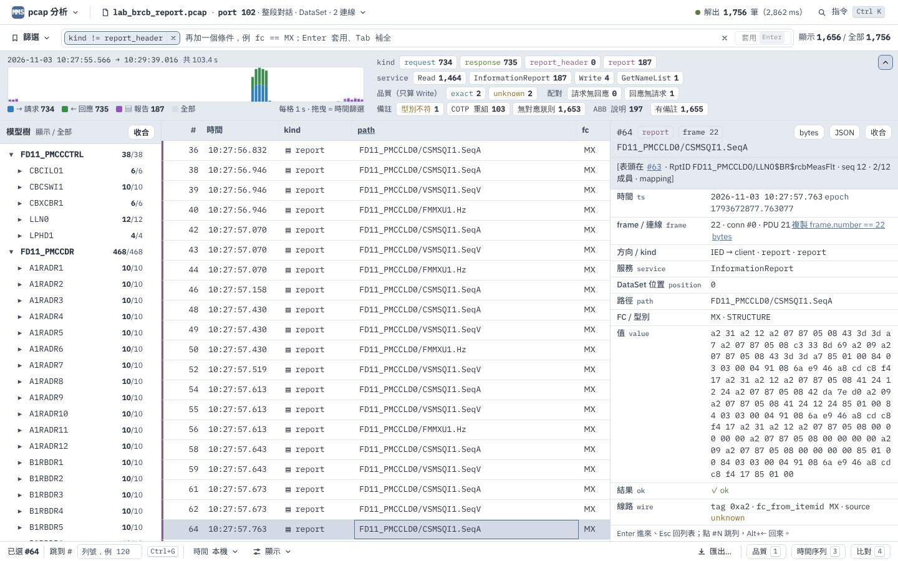 | 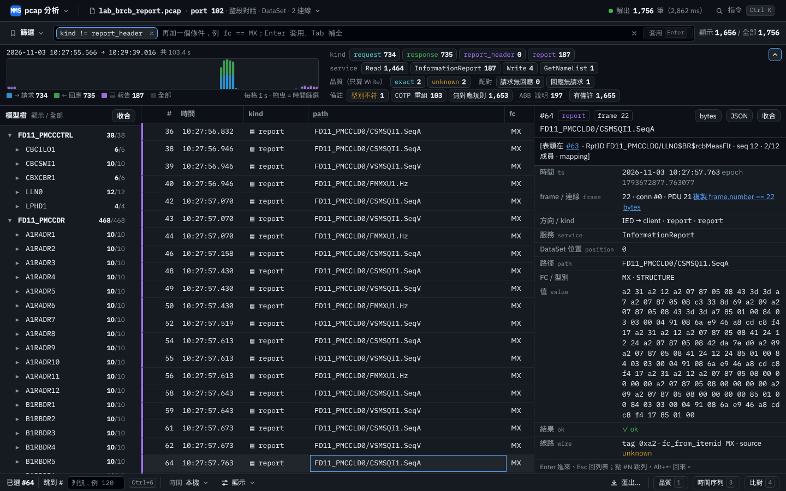 |

- **列 1「我在看什麼」（40 px）**：`MMS pcap 分析 ▾`（選單：開啟檔案、快捷鍵、主題、版本）｜來源晶片 `lab_brcb_report.pcap · port 102 · 整段對話 · DataSet · 2 連線 ▾`｜右側解析狀態「● 解出 1,756 筆（2,862 ms）」與「指令 Ctrl K」。除了晶片 hover 時，這一列沒有框。
- **列 2「我在問什麼」（42 px）**：`篩選 ▾`（書籤＋最近合成一個選單）｜整列寬的條件框（chip、編輯器、✓、×、框內的「套用 Enter」）｜「顯示 1,656 / 全部 1,756」。
- **底部工具列**：已選、跳到 #、`時間 本機 ▾`、`顯示 ▾`（列高、欄位、著色規則、截圖模式）｜靠右：匯出…、品質、時間序列、比對。
- 錯誤時（port 錯）：來源晶片變紅，現有的錯誤卡照舊出現在主畫面；解碼中：右側狀態改成進度。

**打開的樣子**（內容都是快照裡的真實值；解碼面板、連線表等原有彈出層不重畫，只畫新的入口）

| 來源面板 | 選單 |
|---|---|
| 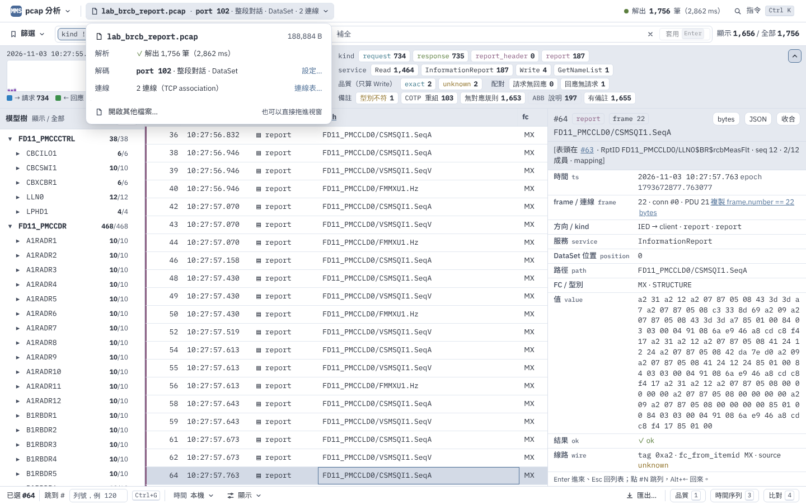 | 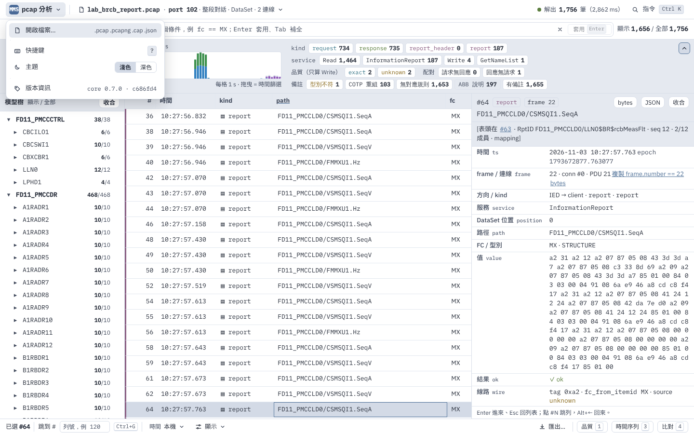 |
| **篩選 ▾（書籤＋最近）** | **顯示 ▾** |
| 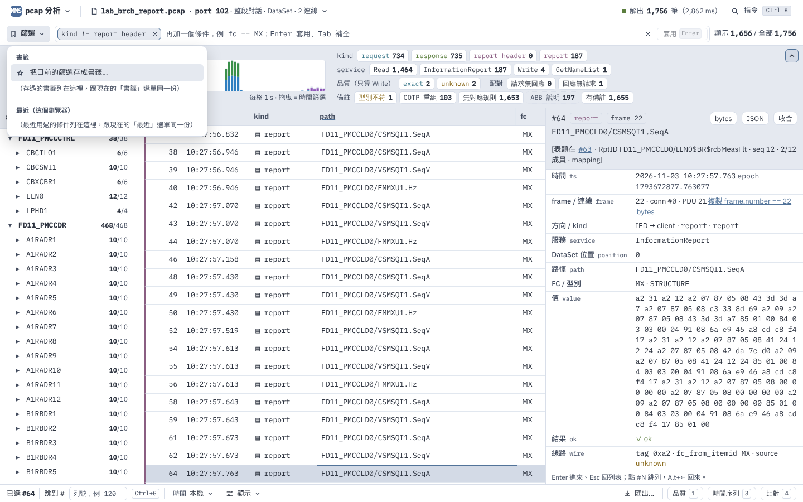 | 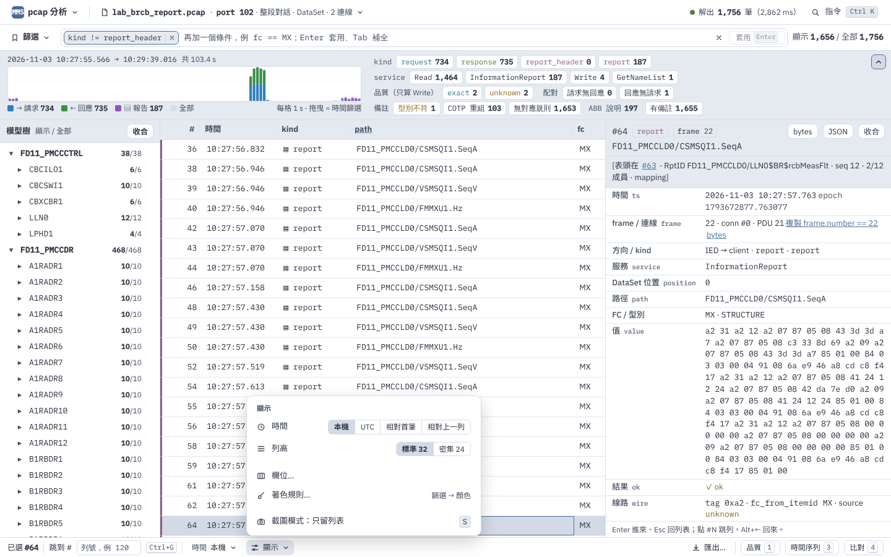 |

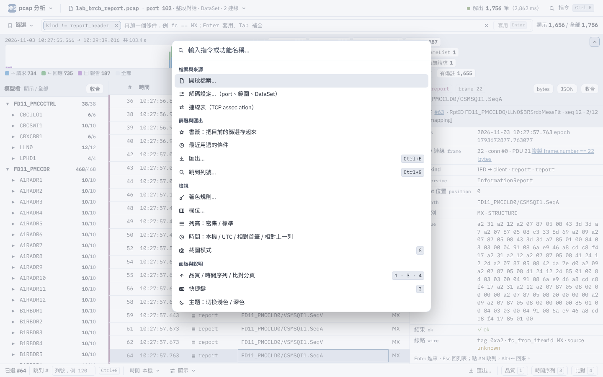

指令面板（新增）是「收進選單也找得到」的保險：所有功能都列在裡面、可以打字找，旁邊標快捷鍵。Ctrl+K 若跟編輯器衝突，可改 Ctrl+Shift+P。

## §4 方案 2：單列指令列

| 淺色 | 深色 |
|---|---|
| 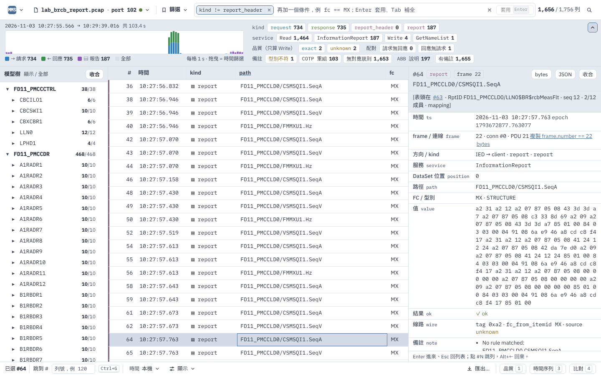 | 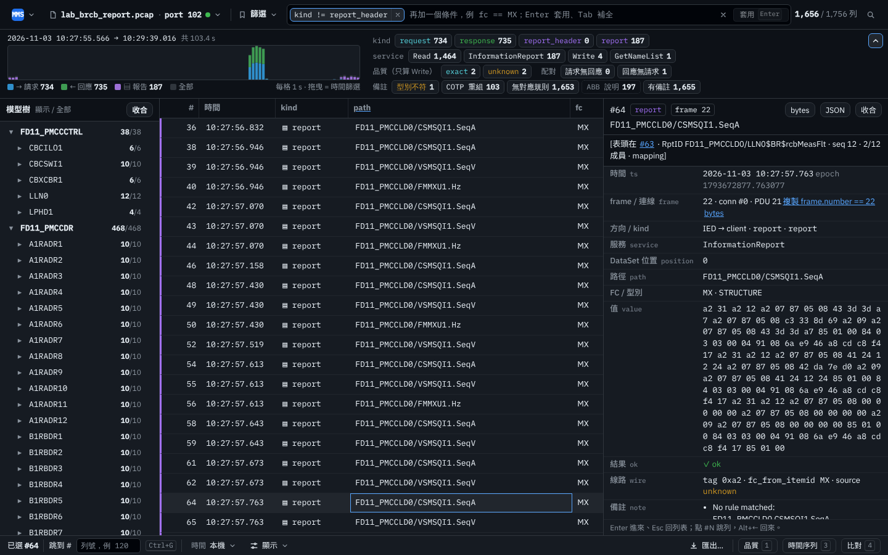 |

- 一列 48 px：`MMS ▾`｜來源晶片（檔名＋port＋狀態點）｜`篩選 ▾`＋條件框｜`1,656 / 1,756 列`｜指令圖示。
- 表頭上移到 y = 160（多 36 px，1440 × 900 多 1–2 列）。
- 代價：篩選框 658 / 818 / 1,298 px，比現在窄；條件一多，chip 要在框內橫向捲。整段對話、DataSet、連線數收進來源面板，不在畫面上。

## §5 方案 3：方案 1 ＋ 總覽改成直方圖帶、計數移到左欄

| 淺色（模型樹分頁） | 深色（模型樹分頁） |
|---|---|
| 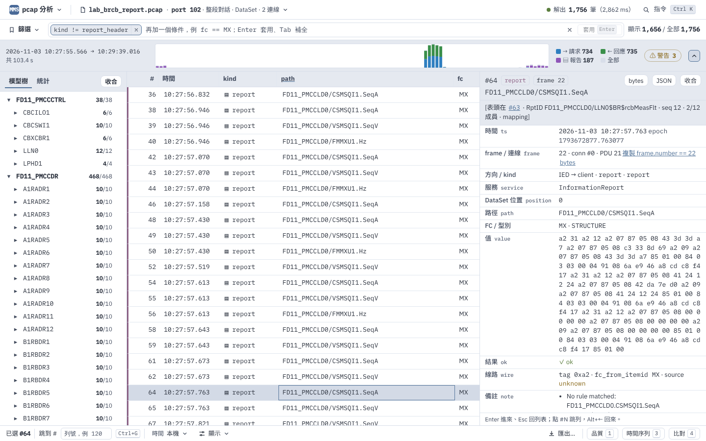 | 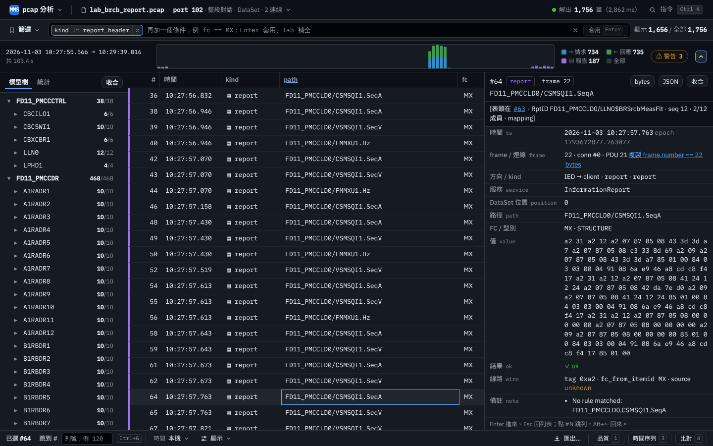 |
| **淺色（統計分頁）** | **深色（統計分頁）** |
| 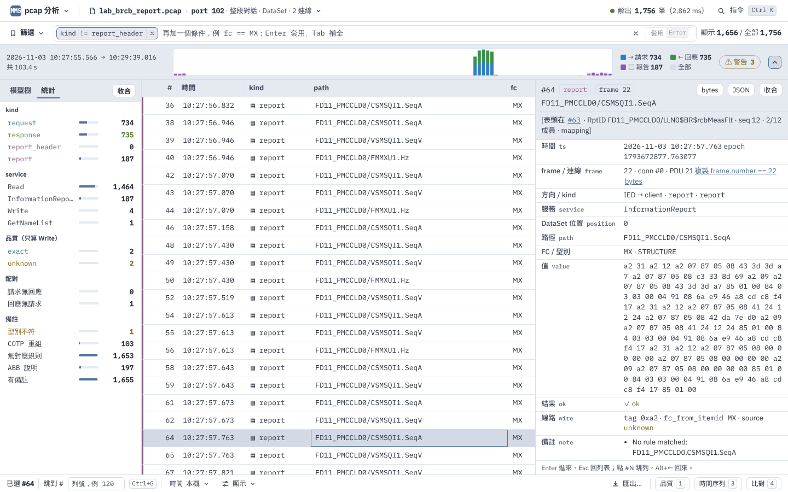 | 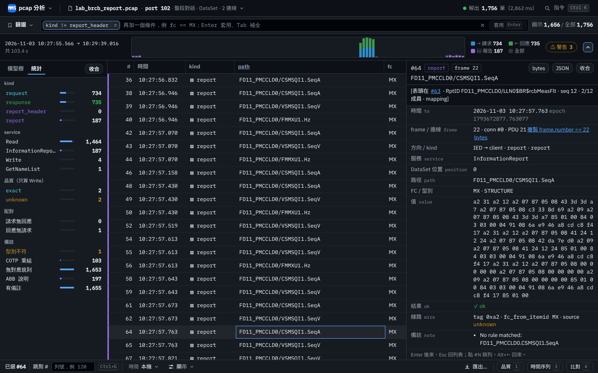 |

- 頂部兩列同方案 1；總覽帶 112 → 64 px：時間範圍、直方圖、圖例（2 × 2）、`⚠ 警告 3`（unknown 2＋型別不符 1，點了開「統計」分頁）、收合。
- 左欄樹頭變成「模型樹｜統計」分頁；「統計」是原本 18 個計數藥丸改成直排清單，每列有比例條，點了一樣加篩選（Kibana Discover 的欄位清單、Datadog 的 facet 面板都是這種放法）。
- 表頭 y = 146，比現在多 50 px；篩選框寬度同方案 1。
- 代價：kind / service 的計數平常要切到「統計」才看得到；只有警告數留在直方圖帶上。

## §6 每個功能搬到哪裡 / Mapping

| 功能 | 現在 | 方案 1 | 方案 2 | 方案 3 |
|---|---|---|---|---|
| 工具名「MMS pcap 分析」 | 頂欄最左（純文字） | 選單鈕「MMS pcap 分析 ▾」 | 選單鈕「MMS ▾」（全名在提示與分頁標題） | 同方案 1 |
| 開啟檔案… | 頂欄按鈕 | 選單 ▸ 開啟檔案…；來源面板 ▸ 開啟其他檔案…；拖進視窗；空白頁的大按鈕 | 同方案 1 | 同方案 1 |
| 檔名＋大小（188,884 B） | 頂欄 `.fname` | 來源晶片（檔名）；來源面板（大小） | 同方案 1 | 同方案 1 |
| 2 連線（連線表） | 頂欄按鈕 ▾ | 來源晶片上的「2 連線」；來源面板 ▸ 連線表…（原彈出層不變） | 來源面板 ▸ 連線表…（晶片只留 port） | 同方案 1 |
| 解碼設定 port 102 · 整段對話 · DataSet | 頂欄按鈕 ▾ | 來源晶片上的完整摘要；來源面板 ▸ 設定…（原面板不變） | 晶片顯示 port 102；其餘在來源面板 | 同方案 1 |
| 解析狀態「解出 1,756 筆（2,862 ms）」 | 頂欄藥丸 | 列 1 右側文字；錯誤時來源晶片變紅＋現有錯誤卡 | 來源晶片上的狀態點；全文在面板與提示 | 同方案 1 |
| 快捷鍵說明 | 頂欄「?」 | 選單 ▸ 快捷鍵（? 鍵不變） | 同方案 1 | 同方案 1 |
| 主題切換 | 頂欄圖示 | 選單 ▸ 主題（淺色 / 深色） | 同方案 1 | 同方案 1 |
| 版本資訊 | 頂欄圖示 | 選單 ▸ 版本資訊（core 0.7.0 · c686fd4） | 同方案 1 | 同方案 1 |
| 篩選條件框（chip、編輯器、✓、×） | 篩選列 | 列 2，加寬到整列 | 指令列中間 | 同方案 1 |
| 套用 | 篩選列按鈕 | 條件框內右側「套用 Enter」 | 同方案 1 | 同方案 1 |
| 最近用過的條件 | 篩選列「最近 ▾」 | 「篩選 ▾」選單 ▸ 最近 | 同方案 1 | 同方案 1 |
| 書籤 | 篩選列「書籤 ▾」 | 「篩選 ▾」選單 ▸ 書籤 | 同方案 1 | 同方案 1 |
| 顯示 1,656 / 全部 1,756 | 篩選列 | 列 2 右側（不變） | 指令列「1,656 / 1,756 列」 | 同方案 1 |
| 著色規則 | 篩選列「著色 ▾」 | 工具列「顯示 ▾」▸ 著色規則…（原對話框不變） | 同方案 1 | 同方案 1 |
| 匯出…（Ctrl+E） | 篩選列按鈕 | 工具列右側「匯出…」（Ctrl+E 不變） | 同方案 1 | 同方案 1 |
| 總覽：直方圖 | 總覽帶 112 px | 不變 | 不變 | 直方圖帶 64 px（時間範圍、圖、圖例、警告數、收合） |
| 總覽：kind / service / 品質 / 配對 / 備註計數 | 總覽帶右半，18 個藥丸 | 不變 | 不變 | 左欄「統計」分頁（直排清單＋比例條，點了一樣加篩選）；直方圖帶上留「⚠ 警告 3」 |
| 收合總覽（網址 ov=0） | 總覽右上 | 不變 | 不變 | 直方圖帶最右 |
| 已選 #64 | 工具列 | 不變 | 同方案 1 | 同方案 1 |
| 跳到 #（Ctrl+G） | 工具列 | 不變 | 同方案 1 | 同方案 1 |
| 時間格式（本機 / UTC / 相對首筆 / 相對上一列） | 工具列四個按鈕 | 工具列「時間 本機 ▾」；「顯示 ▾」裡也有 | 同方案 1 | 同方案 1 |
| 密集（列高 32 / 24） | 工具列按鈕 | 「顯示 ▾」▸ 列高 | 同方案 1 | 同方案 1 |
| 欄位 | 工具列「欄位 ▾」 | 「顯示 ▾」▸ 欄位…（原選單不變） | 同方案 1 | 同方案 1 |
| 品質 1 / 時間序列 3 / 比對 4 | 工具列 | 不變，靠右 | 同方案 1 | 同方案 1 |
| 截圖模式 S | 工具列按鈕 | 「顯示 ▾」▸ 截圖模式（S 鍵不變） | 同方案 1 | 同方案 1 |
| 收合模型樹（T） | 樹頭 | 不變 | 不變 | 樹頭變成「模型樹｜統計」分頁＋收合 |
| 指令面板（新增） | — | 列 1 右側「指令 Ctrl K」；所有上面的功能都能打字找到 | 指令列最右（圖示） | 同方案 1 |

**快捷鍵**：原有的全部不變——`?` 快捷鍵說明、`Ctrl+E` 匯出、`Ctrl+G` 跳到列號、`1 / 3 / 4` 品質 / 時間序列 / 比對分頁、`S` 截圖模式、`T` 收合模型樹、`D` 收合詳情、`J` 跳到節點的第一列、`Enter / Esc / Alt+←` 詳情進出、回上一筆、`Tab` 篩選補全；新增 `Ctrl+K` 指令面板。

## §7 檢查 / Checks

- 1280 × 800、1440 × 900、1920 × 1080 三種寬度，三個方案的頂欄、篩選列、工具列都不折行、沒有元素被切、檔名不被截（腳本逐一量子元素邊界與 `text-overflow`）；console 錯誤 0。
- 對比：搬動不改配色；DOM 實測最低值跟現況一樣（淺色 `#63` 連結 4.04、深色 `.fid` 3.77），這兩個是現有配色的問題，套任一風格方向就會修掉（見風格第一輪 §1.3）。新加的元件（來源晶片、選單、工具列項目）都用既有變數，沒有新的低對比組合。
- 套其他風格也成立：下面是方案 1 套風格 B（深色）。

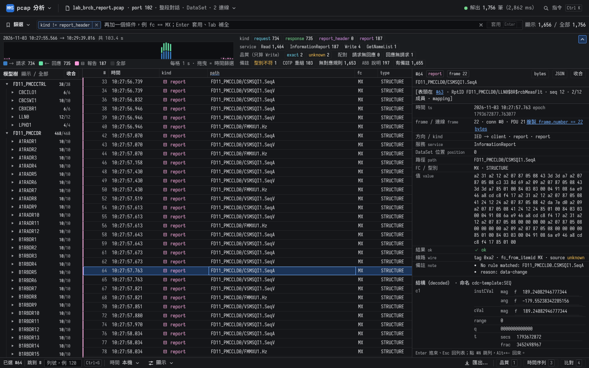

## §8 落地要動的地方 / Implementation

1. **頂欄**：新增 `.appbtn`（選單）、`.srcchip`（來源晶片＋來源面板）、`.ststat`（解析狀態）、`.kbtn`（指令面板入口）；拿掉 `.brand`、`.tbtn.out`、`.fname`、兩個 `.anchor` 按鈕、`.pill`、三個 `.tbtn.ib`——它們的行為搬到選單與來源面板，原本的解碼面板與連線表彈出層照用。
2. **篩選列**：`.flabel`＋「最近」＋「書籤」→ 一個 `.qmenu`（「篩選 ▾」，選單分「書籤」「最近」兩段，清單資料不變）；「套用」搬進 `.fbox` 右側（`.qapply`）；「著色」「匯出」移出。
3. **底部工具列**：`.segc` → `時間 本機 ▾`；「密集」「欄位」「截圖」→「顯示 ▾」彈出層；「匯出…」移到右側；品質 / 時間序列 / 比對靠右。
4. **指令面板**（新增）：清單＋輸入即篩＋方向鍵，項目就是 §6 的功能與快捷鍵。
5. **方案 3 另外**：`.overview` 改直方圖帶；`.ovcounts` 的內容改畫在左欄「統計」分頁（點擊行為不變）；樹頭改分頁。
6. 樣式在 [topbar_redesign_2026-11-09/topbar_v3.css](topbar_redesign_2026-11-09/topbar_v3.css)，只用 tokens 變數；版面搬動的參考實作在 `topbar_v3.js`（在快照上跑，示意用，不是正式程式）。

## §9 檔案 / Files

| 路徑 | 內容 |
|---|---|
| `shots/topbar_redesign_2026-11-09/compare_top.png` | 現況與三個方案的頂部、底部工具列對照 |
| `shots/topbar_redesign_2026-11-09/P{1,2,3}_{light,dark}.png` | 主畫面 1440 × 900 |
| `shots/topbar_redesign_2026-11-09/P{1,2,3}_{1280,1920}.png` | 1280 × 800、1920 × 1080 檢查 |
| `shots/topbar_redesign_2026-11-09/P1_open_{src,app,qmenu,disp,pal}.png`、`P1_open_src_dark.png` | 方案 1 打開的選單 / 面板 |
| `shots/topbar_redesign_2026-11-09/P3_facets_{light,dark}.png` | 方案 3 的「統計」分頁 |
| `shots/topbar_redesign_2026-11-09/P1_B_{light,dark}.png` | 方案 1 套風格 B |
| `topbar_redesign_2026-11-09/` | `topbar_v3.css`、`topbar_v3.js`、量測結果（`fbox_widths.json`、`control_counts.json`） |
